# คู่มือการใช้ BirdNET → eBird clipper

แอปนี้รับไฟล์เสียงภาคสนามยาว ๆ แล้วให้ BirdNET หาเสียงนก ตัดเป็นคลิป ให้คุณฟังตรวจทีละคลิป
คลิปที่คุณยืนยันแล้วจะไปรวมที่โฟลเดอร์ **Ready** แยกตาม eBird checklist และชนิด พร้อมอัปโหลดขึ้น eBird / Macaulay Library

> **ทุกชื่อชนิดที่ AI ทายเป็นตัวเลือกให้ฟังตรวจ ไม่ใช่คำตอบ** ฟังยืนยันก่อน Approve ทุกครั้ง
> ตัวช่วยทุกตัวในแอป (Second opinion, ตัวเทียบเสียง, คำเดาประเภทเสียง ฯลฯ) เป็นคำใบ้ หูของคุณตัดสินสุดท้าย

ภาพทั้งหมดในคู่มือนี้ถ่ายจากแอปจริงที่รันกับ **ข้อมูลตัวอย่าง**: เสียง 6 นาทีจากเครื่องอัด Zoom
และ checklist สมมติชื่อ *Demo Wetland Park* (รหัส S123456781) พิกัดเป็นจุดกลางเมืองอู่ฮั่น
ข้อความในหน้าจอของคุณจะต่างตามข้อมูลจริง ส่วนรายละเอียดเชิงเทคนิคทั้งหมดอยู่ใน [README.md](README.md)

---

## สารบัญ

1. [เริ่มใช้ครั้งแรก](#1-เริ่มใช้ครั้งแรก)
2. [ภาพรวมงานหนึ่งวันภาคสนาม](#2-ภาพรวมงานหนึ่งวันภาคสนาม)
3. [หน้าต่างหลัก](#3-หน้าต่างหลัก)
4. [แท็บ Settings ทีละช่อง](#4-แท็บ-settings-ทีละช่อง)
5. [ผูกไฟล์เสียงกับ eBird checklist (Field logs)](#5-ผูกไฟล์เสียงกับ-ebird-checklist-field-logs)
6. [วิเคราะห์เสียง](#6-วิเคราะห์เสียง)
7. [ตรวจคลิป (แท็บ Review clips)](#7-ตรวจคลิป-แท็บ-review-clips)
8. [ฟังละเอียด: Listen tools (หน้าเสียง Prism)](#8-ฟังละเอียด-listen-tools-หน้าเสียง-prism)
9. [เทียบกับเสียงอ้างอิง: Compare Hz…](#9-เทียบกับเสียงอ้างอิง-compare-hz)
10. [เพิ่มคลิปเอง: Add clip yourself…](#10-เพิ่มคลิปเอง-add-clip-yourself)
11. [ค้นเสียงเพิ่ม: เมนู Find sounds ▾](#11-ค้นเสียงเพิ่ม-เมนู-find-sounds-)
12. [ดูความคืบหน้าและความแม่น: Review progress…](#12-ดูความคืบหน้าและความแม่น-review-progress)
13. [อัปโหลดขึ้น eBird / Macaulay Library](#13-อัปโหลดขึ้น-ebird--macaulay-library)
14. [รวมคลิป: แท็บ Merge clips](#14-รวมคลิป-แท็บ-merge-clips)
15. [งานที่แอปทำให้เองเบื้องหลัง](#15-งานที่แอปทำให้เองเบื้องหลัง)
16. [ข้อมูลของคุณ การย้ายไฟล์ และการส่งให้เพื่อน](#16-ข้อมูลของคุณ-การย้ายไฟล์-และการส่งให้เพื่อน)
17. [แก้ปัญหาที่พบบ่อย](#17-แก้ปัญหาที่พบบ่อย)
18. [คำศัพท์](#18-คำศัพท์)

---

## 1. เริ่มใช้ครั้งแรก

### 1.1 เครื่องที่ใช้ได้

| | ต้องการ |
|---|---|
| Mac | ชิป Apple Silicon (M1 ขึ้นไป) และ macOS Sequoia 15.2 ขึ้นไป (Mac ชิป Intel ใช้ไม่ได้) |
| Windows | Windows 10/11 64-bit ใช้รุ่น zip สำหรับ Windows |
| พื้นที่ | โปรแกรมประมาณ 700 MB และโมเดล BirdNET ประมาณ 300 MB เสียงอ้างอิงที่โหลดเก็บไว้อาจเพิ่มเป็นหลาย GB |
| อินเทอร์เน็ต | วิเคราะห์ได้โดยไม่ต้องต่อเน็ต ใช้เน็ตเฉพาะตัวช่วยที่ดึงข้อมูลจาก xeno-canto และ eBird |
| ติดตั้งเพิ่ม | ไม่ต้อง: Python, ffmpeg และโมเดล BirdNET อยู่ในโฟลเดอร์โปรแกรมแล้ว (รุ่น zip) |

### 1.2 เปิดแอป

**Mac**
1. ดับเบิลคลิก `BirdNET-eBird.command` ในโฟลเดอร์โปรแกรม (หรือตัวเปิด `BirdNET eBird.app` บน Desktop ถ้ามี)
2. ครั้งแรกบนเครื่องใหม่ macOS อาจบอกว่าเปิดไม่ได้ เพราะโปรแกรมไม่ได้ลงชื่อกับ Apple
   ให้ไปที่ **System Settings › Privacy & Security** เลื่อนลงไปกด **Open Anyway** แล้วเปิดอีกครั้ง
3. ครั้งต่อไปดับเบิลคลิกได้เลย

**Windows**
1. คลิกขวาไฟล์ zip › Properties › ติ๊ก **Unblock**
2. แตก zip ไว้ที่สั้น ๆ เช่น `C:\BirdNET-eBird-win`
3. ดับเบิลคลิก `Create desktop shortcut.bat` ครั้งเดียว แล้วเปิดจากไอคอนบน Desktop
   (รายละเอียดอยู่ใน `README-Windows.txt` ในไฟล์ zip)

**โค้ดจาก GitHub**: repo มีเฉพาะโค้ด ไม่มี Python, ffmpeg และโมเดล BirdNET
ถ้าไม่ได้พัฒนาต่อ ให้ใช้รุ่น zip ที่แจก ผู้พัฒนาดู README หัวข้อ 12

### 1.3 ใส่ API key (ไม่บังคับ แต่ช่วยตรวจได้มาก)

แอปวิเคราะห์ได้โดยไม่มี key แต่ตัวช่วยหลายตัวต้องใช้ key ของคุณเอง (ขอฟรี)

| key | ขอได้ที่ | ใช้กับ |
|---|---|---|
| xeno-canto API key | xeno-canto.org/account (สมัครสมาชิกแล้วดูในหน้า account) | Reference sounds…, Second opinion, หาเสียงอ้างอิงในตัวเทียบเสียง, การเดา song/call, Auto-checks |
| eBird API key | ebird.org/api/keygen (ล็อกอินบัญชี eBird) | ดึงข้อมูลจากลิงก์ checklist, บรรทัด eBird (รายงานใกล้จุดบันทึก และช่วงเดียวกันของปีก่อน ๆ) |

วิธีใส่: แท็บ **Settings** › หมวด **API keys** › วาง key ในช่อง › กด **Save key** (ทำทีละช่อง)

key เก็บอยู่ในไฟล์ `data/settings.json` ในเครื่องคุณเท่านั้น **อย่าส่งไฟล์นี้ให้ใคร**
ถ้าส่งโปรแกรมให้เพื่อน ใช้สคริปต์สร้าง zip ซึ่งไม่ใส่ไฟล์นี้ (ข้อ 16)

### 1.4 จัดโฟลเดอร์ (แนะนำ)

แอปทำงานได้กับทุกโฟลเดอร์ แต่ถ้าจัดแบบนี้ แอปจะหาไฟล์เสียงและรูปของวันเดียวกันได้เอง
และเก็บผลวิเคราะห์ไว้กับวันนั้นเลย

```
Birding/
└── 2026/
    └── Nov/
        └── 20261113/
            ├── Pictures/        ← รูปของวันนั้น (แยกโฟลเดอร์ตามชนิดได้ เช่น Pictures/Done/Great Egret/)
            └── Sounds/
                ├── Raw/         ← ไฟล์เสียงจากเครื่องอัด (Zoom เก็บไฟล์ละโฟลเดอร์ย่อยก็ได้)
                └── Done/        ← แอปสร้างให้เอง: ผลวิเคราะห์และโฟลเดอร์ Ready ของวันนั้น
```

- ชื่อโฟลเดอร์เดือนเป็น `Nov` หรือ `NOV` ก็ได้
- ไฟล์เสียงที่อยู่นอกโครงสร้างนี้ ผลจะไปเก็บที่ Output folder (ค่าเริ่มต้น `~/BirdNET_eBird`)

---

## 2. ภาพรวมงานหนึ่งวันภาคสนาม

ลำดับงานหลังกลับจากภาคสนาม:

1. จัดการรูป
2. ทำ checklist บน eBird
3. เพิ่มรูปใน checklist
4. **จัดการเสียงด้วยแอปนี้**
5. อัปรูปขึ้น Google Drive

ในขั้นที่ 4 ทำตามนี้:

```
① ผูกไฟล์เสียงกับ checklist   Settings › Field logs › วางลิงก์ checklist › Add link        (ข้อ 5)
          ▼
② วิเคราะห์                   ▶ Analyze › เลือกโฟลเดอร์ Sounds/Raw › Start analysis       (ข้อ 6)
          ▼
③ ตรวจคลิป                    Review clips: ฟัง › แก้ชนิดถ้าผิด › ให้คะแนน › Approve / Reject (ข้อ 7–9)
          ▼
④ หาเสียงที่พลาด (ถ้าต้องการ)  ✚ Add clip yourself… / Find sounds ▾                         (ข้อ 10–11)
          ▼
⑤ อัปโหลด                     Upload sheet… › อัปไฟล์ใน Ready ขึ้น eBird ทีละ checklist     (ข้อ 13)
```

> ทำขั้น ① ก่อนวิเคราะห์ดีที่สุด เพราะแอปจะใช้พิกัดของ checklist กับไฟล์เสียงที่ไม่มีพิกัดในตัว
> ถ้าลืม ทำทีหลังได้ แอปจะย้ายคลิปใน Ready ให้ตรง checklist เอง

---

## 3. หน้าต่างหลัก

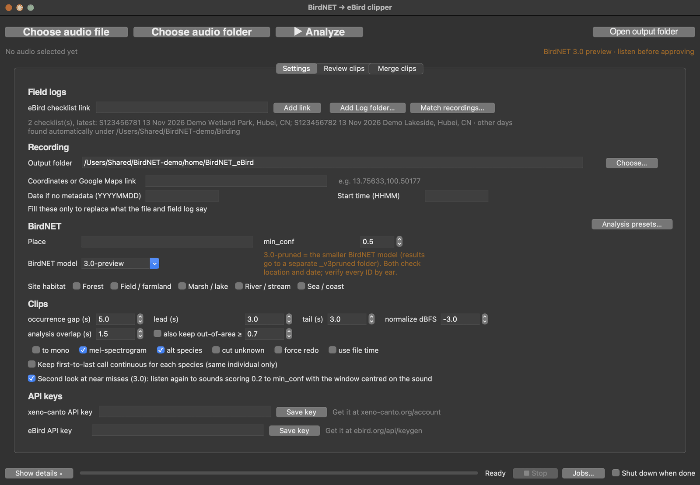

หน้าต่างหลักมี 4 ส่วน เรียงจากบนลงล่าง:

**① แถบบนสุด (เห็นตลอด)**

| ปุ่ม | ทำอะไร |
|---|---|
| **Choose audio file** | เลือกไฟล์เสียงไฟล์เดียว แล้วเปิดหน้าต่าง Recording details |
| **Choose audio folder** | เลือกทั้งโฟลเดอร์ (รวมโฟลเดอร์ย่อย) แอปข้ามผลวิเคราะห์เดิม (`Done`, `Ready`) และไฟล์ซ่อน |
| **▶ Analyze** | กดได้ตลอด ยังไม่ได้เลือกเสียง = เปิดหน้าเลือกโฟลเดอร์ที่ `Sounds/Raw` ของวัน, เลือกแล้ว = วิเคราะห์ไฟล์/โฟลเดอร์นั้นอีกครั้งด้วยค่าปัจจุบัน |
| **Open output folder** | เปิดโฟลเดอร์ผลลัพธ์ใน Finder |

ใต้ปุ่มบอกไฟล์ที่เลือก วันเวลาและพิกัดที่แอปอ่านได้ (*Detected: …*) และโมเดลที่ใช้ (ตัวส้มด้านขวา)

**② แท็บ** — เรียงตามลำดับงาน: **Settings** (ตั้งค่า) › **Review clips** (ตรวจ) › **Merge clips** (รวมคลิป)

**③ เนื้อหาของแท็บ**

**④ แถบสถานะ (ล่างสุด เห็นตลอด)**

| ส่วน | ทำอะไร |
|---|---|
| **Show details ▴** | เปิดช่อง log ของงาน (ลากเส้นแบ่งปรับขนาดได้) ใช้ดูว่างานทำอะไรอยู่หรือผิดพลาดตรงไหน |
| แถบความคืบหน้า + ข้อความ | เช่น `Analyzing 261113_123302_TrMic.WAV · 00:06` หรือ `Auto-checks: 14 clip(s) … · 1 queued` |
| **■ Stop** | หยุดงานที่รันอยู่อย่างปลอดภัย ไฟล์ที่เสร็จแล้วยังอยู่ สั่งใหม่จะทำต่อจากที่เหลือ |
| **Jobs…** | ดูงานที่รันอยู่และคิว (ข้อ 6.4) |
| **Shut down when done** | ติ๊กแล้ว เมื่องานทั้งหมดเสร็จ แอปนับถอยหลัง 60 วินาที (กด Cancel ได้) แล้วปิดเครื่อง ใช้ครั้งเดียว ไม่จำค่า |

- ปิดแอประหว่างวิเคราะห์ได้ แอปถามยืนยันก่อน แล้วหยุดอย่างปลอดภัยเหมือนกด Stop
- Cmd+Q และการสั่งปิดเครื่องก็หยุดงานอย่างปลอดภัยเช่นกัน

---

## 4. แท็บ Settings ทีละช่อง

แท็บนี้แบ่งเป็น 5 หมวด ส่วนใหญ่ตั้งครั้งเดียวแล้วไม่ต้องแตะอีก

### 4.1 Field logs

| ช่อง / ปุ่ม | ทำอะไร |
|---|---|
| **eBird checklist link** + **Add link** | วางลิงก์ checklist (วางหลายลิงก์พร้อมกันได้) แล้วดึงข้อมูลจาก eBird (ต้องมี eBird API key) |
| **Match recordings…** | เปิดหน้าต่างเลือกว่าไฟล์เสียงแต่ละไฟล์อยู่ checklist ไหน |
| ข้อความสีเทา | สรุป checklist ที่เพิ่มไว้ |

รายละเอียดและขั้นตอนอยู่ในข้อ 5

### 4.2 Recording

| ช่อง | ค่าเริ่มต้น | ความหมาย |
|---|---|---|
| **Output folder** + Choose… | `~/BirdNET_eBird` | ที่เก็บผล เมื่อเลือกเสียงใน `<YYYYMMDD>/Sounds` แอปเปลี่ยนเป็น `Sounds/Done` ของวันนั้นให้เอง เลือกที่อื่นทับได้หลังเลือกเสียง |
| **Coordinates or Google Maps link** | ว่าง | พิกัดแบบ `13.75633,100.50177` หรือวางลิงก์ Google Maps |
| **Date if no metadata (YYYYMMDD)** | ว่าง | วันที่อัด |
| **Start time (HHMM)** | ว่าง | เวลาเริ่มอัด |

> สามช่องล่าง **กรอกเฉพาะเมื่ออยากแทนค่าในไฟล์และ Field log** กรอกแล้วกด ▶ Analyze แอปใช้ค่านี้กับทุกไฟล์ในครั้งนั้น
> เลือกไฟล์ใหม่แล้วช่องจะว่างเอง ปกติปล่อยว่างไว้ แล้วกรอกเฉพาะที่ขาดในหน้าต่าง Recording details

### 4.3 BirdNET

| ช่อง | ค่าเริ่มต้น | ความหมาย |
|---|---|---|
| **Place** | ว่าง | ชื่อสถานที่ เก็บไว้ใน summary.xlsx |
| **min_conf** | 0.5 | คะแนน BirdNET ขั้นต่ำที่จะตัดเป็นคลิป ลดลงได้คลิปเพิ่ม แต่ทายผิดมากขึ้นมาก |
| **BirdNET model** | 3.0-preview | `3.0-pruned` = รุ่นย่อ ไว้เปรียบเทียบเท่านั้น (ผลแยกโฟลเดอร์ `_v3pruned`) ทดลองแล้วพลาดคลิปที่ถูกมากกว่ารุ่นเต็ม |
| **Site habitat** | ไม่ติ๊ก | ถิ่นอาศัยของจุดที่อัด (Forest, Field / farmland, Marsh / lake, River / stream, Sea / coast) ติ๊กแล้วนกที่ถิ่นอาศัยไม่เข้ากัน เช่น นกน้ำในป่า ต้องได้คะแนน 0.8 ขึ้นไปจึงจะแสดง พร้อมคำเตือน |
| **Analysis presets…** | | บันทึกและเรียกชุดตั้งค่าที่ใช้บ่อย (ข้อ 4.6) |

### 4.4 Clips

| ช่อง | ค่าเริ่มต้น | ความหมาย |
|---|---|---|
| **occurrence gap (s)** | 5.0 | เสียงชนิดเดียวกันที่ห่างกันไม่เกินนี้ รวมเป็นคลิปเดียว |
| **lead / tail (s)** | 3.0 / 3.0 | เผื่อก่อนเสียงแรกและหลังเสียงสุดท้ายของคลิป |
| **normalize dBFS** | −3.0 | ระดับเสียงสูงสุดของคลิป |
| **analysis overlap (s)** | 1.5 | BirdNET ฟังทีละ 3 วินาที เลื่อนทีละ (3 − ค่านี้) วินาที |
| **also keep out-of-area ≥** | ปิด (0.7) | เก็บชนิดที่ไม่ควรพบที่นั่นช่วงนั้นไว้ด้วย ถ้าคะแนนถึงเกณฑ์ ใช้หานกหลงถิ่น (ได้ผลผิดเพิ่ม) |
| **to mono** | ปิด | แปลงคลิปเป็น mono (ปิด = คง stereo ตามที่อัด ตามคำแนะนำของ Macaulay Library) |
| **mel-spectrogram** | เปิด | สร้างภาพ .png ของคลิปพร้อมกรอบเสียงที่ BirdNET เจอ (ปุ่ม BirdNET boxes ↗ ใช้ภาพนี้) |
| **alt species** | เปิด | บันทึกชนิดอื่นที่ BirdNET เจอในช่วงเดียวกัน |
| **cut unknown** | ปิด | ตัดเสียงที่คะแนนต่ำกว่า min_conf ไปโฟลเดอร์ `_Unknown/` |
| **force redo** | ปิด | **ระวัง**: วิเคราะห์ใหม่แม้เคยทำแล้ว และ **ล้างผลตรวจทุกคลิปกลับเป็น Pending** (คลิปที่คุณเพิ่มเองไม่ถูกลบ) |
| **use file time** | ปิด | บังคับใช้เวลาไฟล์ของเครื่องอัด (ไม่ตรวจว่าน่าเชื่อถือไหม) |
| **Keep first-to-last call continuous…** | ปิด | ต่อเสียงของชนิดเดียวกันเป็นช่วงยาวช่วงเดียว ใช้เมื่อมั่นใจว่าเป็นนกตัวเดียวกัน |
| **Second look at near misses (3.0)** | เปิด | เสียงที่ได้คะแนน 0.2 ถึง min_conf และควรพบที่นี่ ให้ BirdNET ฟังซ้ำแบบวางหน้าต่างตรงกลางเสียง ถึงเกณฑ์ = ได้คลิป คะแนนในตารางขึ้น *(2nd look)* |

### 4.5 API keys

ช่อง **xeno-canto API key** และ **eBird API key** แต่ละช่องมีปุ่ม **Save key** และบอกว่าขอ key ได้ที่ไหน (ข้อ 1.3)

### 4.6 Analysis presets…

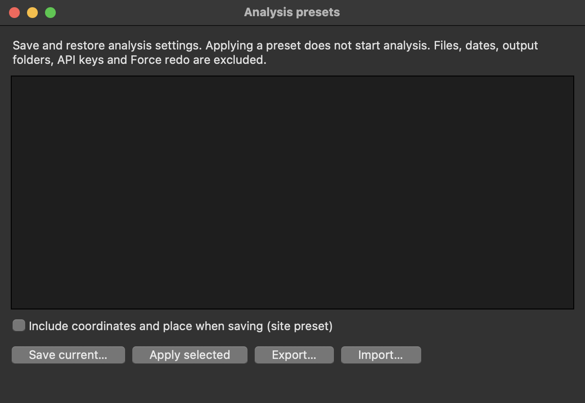

ใช้เก็บชุดตั้งค่าที่ใช้บ่อย เช่น "ป่าเขา" (Forest, min_conf 0.5) กับ "พื้นที่ชุ่มน้ำ" (Marsh / lake)

| ปุ่ม | ทำอะไร |
|---|---|
| **Save current…** | บันทึกค่าปัจจุบันในแท็บ Settings เป็นชุดใหม่ |
| **Apply selected** | ใช้ชุดที่เลือก (ไม่เริ่มวิเคราะห์เอง) |
| **Export… / Import…** | ส่งออก/นำเข้าเป็นไฟล์ JSON ไว้ใช้ในเครื่องอื่น |
| **Include coordinates and place when saving** | ติ๊กแล้วเก็บพิกัดและชื่อสถานที่ไปด้วย (ชุดตั้งค่าประจำจุด) |

ชุดตั้งค่าไม่เก็บ API key, ไฟล์, วันเวลา, Output folder และ force redo

---

## 5. ผูกไฟล์เสียงกับ eBird checklist (Field logs)

**ทำแล้วได้อะไร**
- ไฟล์เสียงที่ไม่มี geotag ใช้พิกัดของ checklist เลย ไม่ต้องกรอกทีละไฟล์
- หน้า Review บอกว่าคลิปอยู่ checklist ไหน และชนิดนั้นมีใน checklist แล้วหรือยัง
- คลิปใน Ready แยกโฟลเดอร์ตาม checklist อัปโหลดทีละ checklist ได้ง่าย
- Upload sheet บอกชนิดที่ต้องเพิ่มใน checklist ก่อนอัปโหลด

### 5.1 เพิ่มจากลิงก์ eBird checklist

1. แท็บ **Settings › Field logs** วางลิงก์ เช่น `https://ebird.org/checklist/S123456781` ในช่อง **eBird checklist link**
   - วางหลายลิงก์พร้อมกันได้ (คั่นด้วยช่องว่างหรือขึ้นบรรทัดใหม่)
2. กด **Add link** (ต้องมี eBird API key)
3. แอปดึงข้อมูลเหล่านี้มาให้: ชนิดและจำนวน จำนวนรูป/เสียงที่แนบแล้ว วันเวลาเริ่ม ระยะเวลา สถานที่ และพิกัด
   - checklist ที่ใช้ location ส่วนตัว (ไม่ใช่ hotspot) แอปก็หาพิกัดได้
4. แก้ checklist บน eBird ทีหลัง (เช่น เพิ่มชนิด) ให้กด Add link ลิงก์เดิมอีกครั้งเพื่อดึงข้อมูลใหม่

### 5.2 หน้าต่าง Match recordings

หลังเพิ่มลิงก์ หน้าต่างนี้เด้งขึ้นเอง หรือเปิดที่ **Settings › Field logs › Match recordings…**

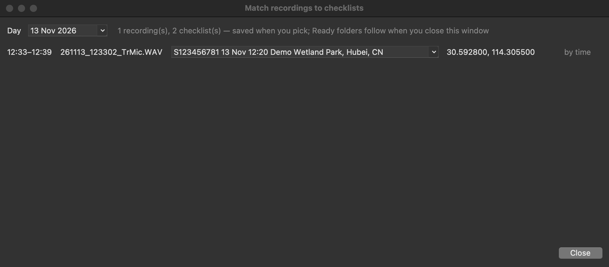

| ส่วน | ความหมาย |
|---|---|
| **Day** | วันที่ดู (มีทุกวันที่มี checklist) |
| แต่ละแถว | ไฟล์เสียงหนึ่งไฟล์ของวันนั้น: ช่วงเวลาอัด ชื่อไฟล์ checklist ที่ใช้ พิกัดที่จะใช้ |
| **drop down** | เลือก checklist ของไฟล์นั้น แอปบันทึกทันทีที่เลือก |
| **by time** | ยังไม่ได้เลือกเอง แอปเดาจากเวลาเริ่มอัด |
| **No checklist** | ไฟล์นี้ไม่อยู่ checklist ไหน คลิปจะไปที่ `Ready/No checklist/` |

- **ปิดหน้าต่าง** แล้วแอปย้ายคลิปที่ตรวจแล้วของวันที่เปิดดูไปโฟลเดอร์ checklist ที่ถูกต้องให้เอง (เข้าคิวงาน)
- ปัดเมาส์ผ่าน drop down ไม่เปลี่ยนค่า (กันเลือกผิดตอนเลื่อนหน้าต่าง)

> **แอปเดาจากเวลาอย่างไร**: ไฟล์ที่เริ่มอัดตั้งแต่ 15 นาทีก่อนเริ่ม checklist จนถึงเวลาจบ checklist ใช้ checklist นั้น
> ถ้า checklist ไม่ได้ใส่ระยะเวลา แอปเดาให้ไม่เกิน 6 ชั่วโมงหลังเริ่ม ไฟล์ที่เกินจากนี้แอปไม่เดา (ไม่มีพิกัด)
> ต้องเลือกใน drop down หรือกรอกพิกัดเองตอนวิเคราะห์ — **วันที่มีหลาย checklist ควรตรวจทุกแถว**

---

## 6. วิเคราะห์เสียง

### 6.1 เลือกไฟล์

- กด **▶ Analyze** (ยังไม่ได้เลือก = แอปเปิดหน้าเลือกโฟลเดอร์ที่ `Sounds/Raw` ของวันให้)
- หรือ **Choose audio file** / **Choose audio folder** เลือกเอง
- เลือกโฟลเดอร์ `Sounds` หรือ `Raw` ทั้งโฟลเดอร์ได้เลย แอปหาไฟล์ในโฟลเดอร์ย่อยให้ และข้ามสิ่งที่วิเคราะห์ไว้แล้วใน `Done` / `Ready`
- รองรับ WAV, MP3, FLAC, M4A, OGG, AIFF

### 6.2 หน้าต่าง Recording details

ขึ้นทุกครั้งก่อนวิเคราะห์ แสดงสิ่งที่แอปอ่านได้ และขอเฉพาะที่ขาด

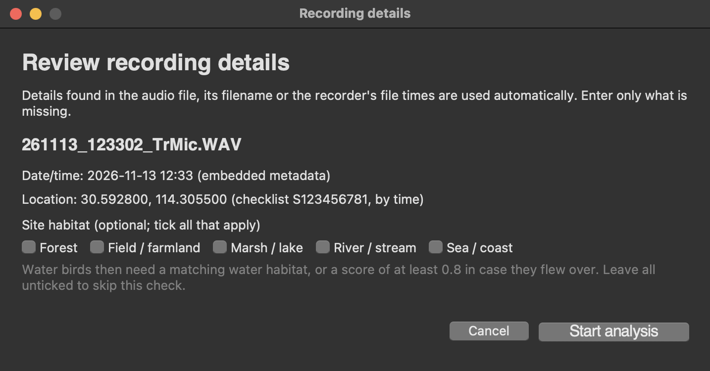

- **Date/time** พร้อมที่มาในวงเล็บ: *embedded metadata* (ในไฟล์), *filename* (ชื่อไฟล์), *file times* (เวลาไฟล์ของเครื่องอัด)
- **Location** พร้อมที่มา เช่น *checklist S123456781, by time* = พิกัดจาก checklist ที่แอปเดาจากเวลา
- ช่องที่ขาดจะขึ้นให้กรอก: วันที่แบบ `20261113`, เวลาเริ่มแบบ `1233`, พิกัดแบบ `13.75633,100.50177` หรือวางลิงก์ Google Maps
- **Site habitat** (ไม่บังคับ): ติ๊กถิ่นอาศัยของจุดที่อัด ติ๊กได้หลายอย่าง เช่น Forest + Marsh / lake
- เลือกทั้งโฟลเดอร์: ค่าที่กรอกใช้เติมเฉพาะไฟล์ที่ขาด ไฟล์ที่มีข้อมูลในตัวใช้ของตัวเอง
- กด **Start analysis** เพื่อเริ่ม หรือ **Cancel**

### 6.3 ระหว่างวิเคราะห์

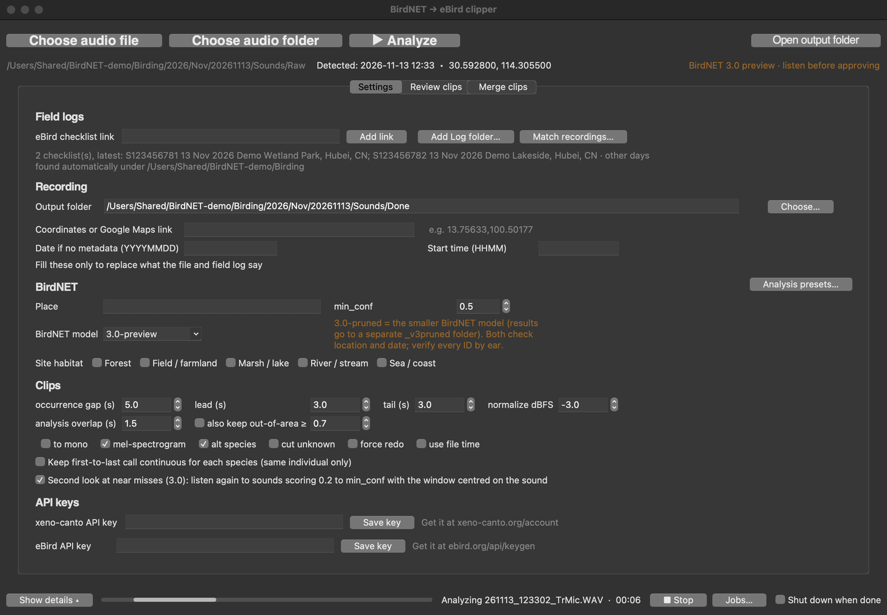

- แถบล่างบอกไฟล์ที่กำลังทำ ลำดับไฟล์ เวลาที่ใช้ และจำนวนงานในคิว
- Output folder เปลี่ยนเป็น `Sounds/Done` ของวันนั้นเอง (ดูในภาพ)
- เลือกไฟล์อื่นต่อได้เลยระหว่างงานรัน งานใหม่จะต่อคิวเอง
- เวลาที่ใช้: ไฟล์ยาว 1 ชั่วโมงใช้ไม่กี่นาที ขึ้นกับเครื่อง

### 6.4 หน้าต่าง Jobs

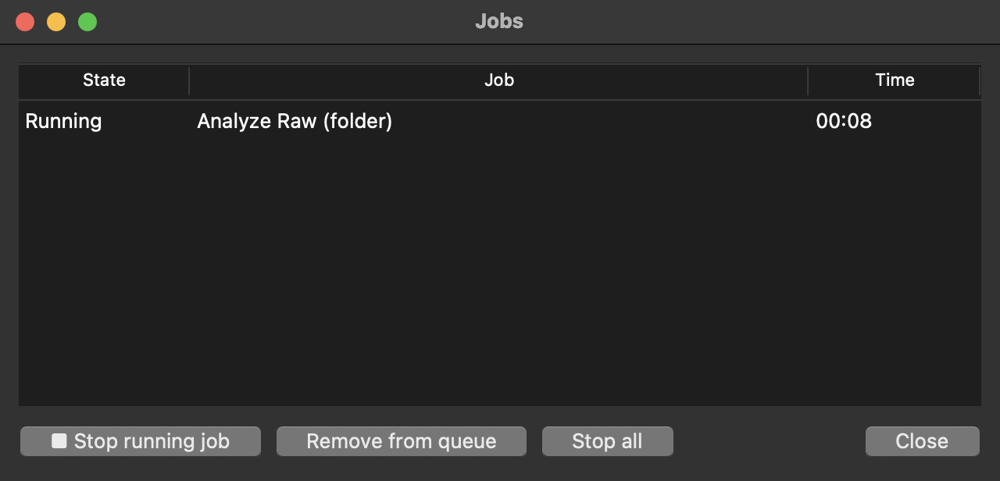

| ปุ่ม | ทำอะไร |
|---|---|
| **Stop running job** | หยุดงานที่รันอยู่ (ปลอดภัย ทำต่อได้) |
| **Remove from queue** | เอางานที่เลือกออกจากคิว |
| **Stop all** | หยุดงานที่รันอยู่และล้างคิว |

งานที่คุณสั่ง (วิเคราะห์ เพิ่มคลิป รวมคลิป) มาก่อนงานเบื้องหลังเสมอ งานเบื้องหลังที่รันอยู่จะหยุดอย่างปลอดภัยแล้วทำต่อทีหลัง

### 6.5 เมื่อเสร็จ

- แอปเปิดแท็บ **Review clips** ที่ผลชุดแรก ผลชุดอื่นอยู่ในเมนู **Results** ทันที ไม่ต้องกด Refresh list
- เปิดแอปครั้งหน้า แอปกลับมาที่ผลชุดล่าสุดเอง ไม่ต้องวิเคราะห์ใหม่
- เลือกไฟล์เดิมที่เคยวิเคราะห์ด้วยค่าเดิม แอปเปิดผลเดิมให้ ไม่วิเคราะห์ซ้ำ (ใช้ force redo ถ้าต้องการจริง ๆ)

### 6.6 BirdNET ทำอะไรกับไฟล์ (สรุป)

1. ฟังทีละ 3 วินาที เลื่อนทีละ 1.5 วินาที
2. ตัดชนิดที่ไม่ควรพบที่จุดนั้นในสัปดาห์นั้นทิ้ง (ตัวกรองพื้นที่/ฤดูจากพิกัดและวันที่)
3. ตรวจถิ่นอาศัย (ถ้าติ๊ก Site habitat)
4. ฟังซ้ำเสียงที่เกือบถึงเกณฑ์ (Second look)
5. รวมเสียงชนิดเดียวกันที่ห่างกันไม่เกิน 5 วินาทีเป็นหนึ่งคลิป ตัดจากไฟล์ต้นฉบับ เผื่อหน้าหลัง 3 วินาที คงคุณภาพเสียงตามที่อัด
6. เขียนผลลง `summary.xlsx` (หนึ่งแถวต่อคลิป) และภาพ spectrogram ของแต่ละคลิป

**ไฟล์ต้นฉบับไม่ถูกแก้ไขเลย**

---

## 7. ตรวจคลิป (แท็บ Review clips)

### 7.1 หน้าจอ

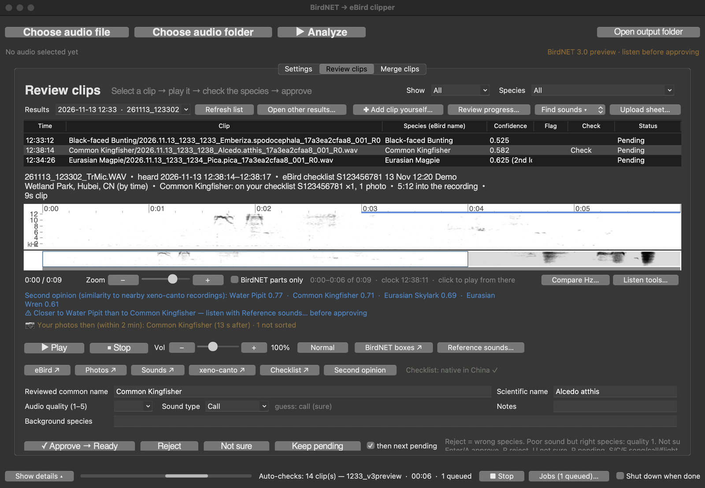

**แถวบนสุด**

| ส่วน | ทำอะไร |
|---|---|
| **Show** | กรองตามสถานะ: All, Pending (ยังไม่ตรวจ), Approved, Rejected, Not sure, Check (มีคำเตือน), Near a flag (ใกล้จุดที่กด MARK) |
| **Species** | แสดงเฉพาะชนิดเดียวในผลชุดนี้ (All = ทุกชนิด) |
| **Results** | ผลทุกชุดจากทุกโฟลเดอร์ที่เคยใช้ ใหม่สุดก่อน เช่น *2026-11-13 12:33 · 261113_123302* |
| **Refresh list** | อ่านรายการผลใหม่ (ปกติไม่ต้องกด) |
| **Open other results…** | เปิด `summary.xlsx` ที่อยู่ที่อื่น |
| **✚ Add clip yourself…** | เพิ่มคลิปของเสียงที่ BirdNET ไม่เจอ (ข้อ 10) |
| **Review progress…** | ความคืบหน้าและความแม่น (ข้อ 12) |
| **Find sounds ▾** | เครื่องมือค้นเสียงเพิ่ม (ข้อ 11) |
| **Upload sheet…** | รายการไฟล์ที่ต้องอัปโหลดของวันนั้น (ข้อ 13) |

**ตารางคลิป** — คอลัมน์: Time (เวลาจริงที่เสียงเริ่ม), Clip (ไฟล์คลิป), Species (ชื่อตาม eBird), Confidence (คะแนน BirdNET),
Flag (ใกล้จุด MARK), Check (มีเหตุให้ฟังให้ดี), Status
- คลิกหัวคอลัมน์ = เรียงน้อยไปมาก ▲ คลิกซ้ำ = มากไปน้อย ▼ (เวลาเรียงตามเวลาจริง ข้ามเที่ยงคืนก็ถูก)
- คะแนน *0.625 (2nd look)* = คลิปที่ได้จากการฟังซ้ำ
- คลิปที่คุณเพิ่มเองขึ้นว่า *added by you* และไม่มีคะแนน

**บรรทัดรายละเอียดคลิป** (ใต้ตาราง) เช่น
*261113_123302_TrMic.WAV • heard 2026-11-13 12:38:14–12:38:17 • eBird checklist S123456781 13 Nov 12:20 Demo Wetland Park, Hubei, CN (by time) • Common Kingfisher: on your checklist S123456781 ×1, 1 photo • 5:12 into the recording • 9s clip*
- **heard …** = วันเวลาจริงที่ได้ยินเสียง ไว้เทียบกับเวลาในรูป
- **eBird checklist …** = checklist ที่ไฟล์เสียงนี้ใช้ (*by time* = แอปเดา, *your choice* = คุณเลือกเอง)
- **on your checklist … ×1, 1 photo** หรือ **not on your eBird checklist** = ชนิดนี้มีใน checklist ของคุณหรือยัง
- **5:12 into the recording** = ตำแหน่งในไฟล์ต้นฉบับ

### 7.2 ฟังเสียงและอ่านภาพ

ภาพเสียงเป็นแบบหน้าเสียงของ Macaulay Library: ขาวดำ ความถี่ 0–12 kHz เห็นทีละ 6 วินาที

| ทำอะไร | วิธี |
|---|---|
| เล่นจากจุดใดก็ได้ | **คลิกบนภาพ** (ขณะเล่น เส้นตำแหน่งอยู่กลางภาพ ภาพเลื่อนผ่านเส้น) |
| เล่น / หยุด | **▶ Play / ■ Stop** หรือ Space |
| ย่อขยายเวลา | **Zoom − / แถบ / +** หรือกด − / + บนภาพ เห็นทีละ 1.5–60 วินาที |
| เลื่อนภาพ | ← / → ทีละหน้า หรือคลิก/ลากแถบเล็กด้านล่าง (แถบเล็ก = ทั้งคลิป ช่วงที่เห็นสว่าง) |
| ดูช่วงที่ BirdNET เจอ | แถบฟ้าเหนือภาพ |
| เวลาจริงของจุดใด | ชี้เมาส์บนภาพ (ข้อความใต้ภาพบอก *clock …*) |
| ดูภาพที่มีกรอบเสียงของ BirdNET | **BirdNET boxes ↗** |
| ปรับระดับเสียง | **Vol − / แถบ / +** (0–300%) ปุ่ม **Normal** กลับไป 100% |

**BirdNET parts only** (ติ๊กใต้ภาพ): ดูและฟังเฉพาะช่วงที่ BirdNET ได้ยินชนิดนี้ ต่อกัน ตัดช่วงเผื่อและช่องว่างออก
เส้นแดง = รอยต่อ ตัวเลขเวลายังเป็นเวลาจริงในคลิป และบอกว่าได้ยินกี่วินาที เช่น *0:03–0:13 of 0:34 (heard 0:20)*
เหมาะกับคลิปยาวที่มีเสียงหลายช่วง แอปจำค่านี้ไว้ครั้งหน้า และไม่เปลี่ยนไฟล์คลิป

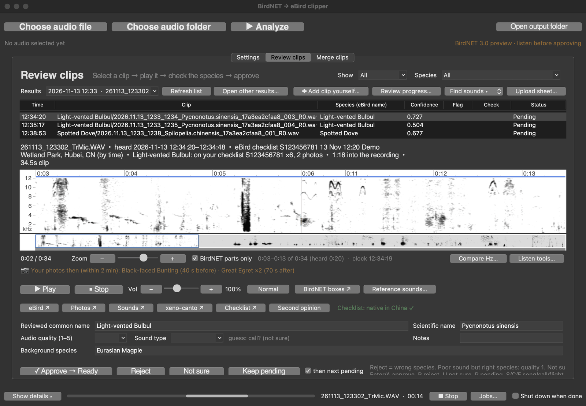

**ระดับเสียง (Vol)**
- ค่าเดียวใช้ทุกหน้าที่ฟังเสียง และแอปจำไว้
- ปรับระหว่างเล่นได้ เสียงเล่นต่อจากจุดเดิมที่ระดับใหม่ (อาจเงียบไปแวบหนึ่ง)
- เกิน 100% = ขยายเสียงเบาให้ฟังผ่านลำโพงได้ ส่วนที่ดังมากถูกบีบไม่ให้แตก จึงฟังต่างจากต้นฉบับเล็กน้อย
- มีผลเฉพาะเสียงที่ฟัง ไม่แตะไฟล์คลิป ไฟล์ใน Ready หรือสิ่งที่อัปโหลด

### 7.3 บรรทัดช่วยตรวจ (ใต้ภาพ)

| บรรทัด | สี | บอกอะไร |
|---|---|---|
| **Second opinion** | ฟ้า | เทียบคลิปกับเสียงอ้างอิงจาก xeno-canto ใกล้จุดบันทึก เรียงชนิดที่คล้ายที่สุด เช่น *Water Pipit 0.77 · Common Kingfisher 0.71* และเตือน **⚠ Closer to … than to …** ถ้าคลิปคล้ายชนิดอื่นมากกว่าชนิดที่ทาย |
| **eBird** | เขียว | รายงานชนิดนี้ใกล้จุดบันทึกล่าสุด (รัศมี 25 กม. 30 วัน) และช่วงเดียวกันของปีก่อน ๆ ในมณฑลนี้ เช่น *reported on 16 of 24 days ✓* หรือ **⚠ not reported** (ต้องมี eBird API key) |
| **📷 Your photos then** | ส้ม | ชนิดที่คุณถ่ายรูปไว้ระหว่างเสียงหรือห่างไม่เกิน 2 นาที เช่น *Common Kingfisher (13 s after) · 1 not sorted* |
| **Checklist: …** (ข้างปุ่ม Second opinion) | เขียว | สถานะใน checklist ของประเทศ (จีน ฮ่องกง ไต้หวัน ไทย) เช่น *native in China ✓*, *rarity*, *not on the checklist* หรือ *check the name* (eBird แยกชนิดแล้ว ให้แก้ชื่อก่อน Approve) |

- บรรทัดที่ไม่มีข้อมูลจะซ่อนเอง ภาพเสียงจึงได้พื้นที่มากขึ้น
- **Second opinion** ทำเองเบื้องหลังสำหรับคลิปคะแนนต่ำ (ข้อ 15) หรือกดปุ่ม **Second opinion** เพื่อสั่งเอง (ต้องมี xeno-canto API key ครั้งแรกของแต่ละชนิดอาจใช้ 1–4 นาทีเพื่อโหลดเสียงอ้างอิง)
- **บรรทัดรูป**: อ่านเวลาถ่ายจากรูปในโฟลเดอร์ `Pictures` ของวันนั้น (จัดโฟลเดอร์ตามข้อ 1.4) ไฟล์ JPG / DNG อ่านได้เลย ไฟล์ CR3 ต้องมี exiftool ในเครื่อง
  ชื่อชนิดมาจากชื่อโฟลเดอร์ที่แยกรูปไว้ เช่น `Pictures/Done/Great Egret/` รูปที่ยังไม่ได้แยกนับเป็น *not sorted*
  เวลาในรูปเป็นนาฬิกากล้อง ถ้าไม่ตรงกับเครื่องอัด ตั้ง *Camera minus recorder clock* ในหน้าต่าง Recorder flags (ข้อ 11.6)
  **ถ่ายใกล้เวลาเดียวกันไม่ได้แปลว่าเป็นนกตัวเดียวกัน**

**ช่อง Check ในตาราง** ขึ้นเมื่อมีเหตุให้ฟังให้ดี:
- ชนิดอยู่นอกพื้นที่หรือฤดู (เมื่อเปิด also keep out-of-area)
- ไม่เข้ากับ Site habitat ที่ติ๊ก
- ไม่อยู่ใน checklist ของประเทศ
- ไม่มีรายงานใน eBird ช่วงเดียวกันของปีก่อน ๆ
- Second opinion ว่าคล้ายชนิดอื่นมากกว่า
- มีเสียงแมลง กบ หรือสัตว์อื่นดังแข่งในช่วงเดียวกัน
- ML model ในเครื่อง (ที่เรียนจากผลตรวจของคุณ) ว่าเสี่ยงผิด

**Check ไม่ได้แปลว่าผิด** แค่ควรฟังให้ดีก่อนตัดสิน

### 7.4 ปุ่มค้นข้อมูลชนิด

| ปุ่ม | เปิดอะไร |
|---|---|
| **Reference sounds…** | หน้าต่างเสียงอ้างอิงจาก xeno-canto ของชนิดนี้ เรียงคุณภาพดีและใกล้จุดบันทึกก่อน กรอง song/call ได้ สลับฟังกับคลิปของคุณ (ต้องมี xeno-canto API key) |
| **eBird ↗** | หน้าชนิดบน eBird (รูป เสียง แผนที่) |
| **Photos ↗ / Sounds ↗** | Macaulay Library เรียงคะแนนสูงสุด (Sounds กรองตามมณฑลของจุดบันทึก) |
| **xeno-canto ↗** | หน้าชนิดบน xeno-canto |
| **Checklist ↗** | eBird checklist ที่ไฟล์เสียงนี้ใช้ |

ปุ่มเหล่านี้ใช้ชื่อในช่อง Scientific name แก้ชนิดแล้วจะค้นชนิดใหม่

### 7.5 ช่องตรวจและการตัดสิน

| ช่อง | วิธีใช้ |
|---|---|
| **Reviewed common name** | แอปเติมชื่อตาม eBird ให้ **แก้เป็นชนิดอื่นได้**: คลิกช่อง = ตัวเลือกของคลิปนี้ก่อน (ชนิดจาก Second opinion พร้อมค่าความคล้าย แล้วชนิดที่ BirdNET ทายรอง) หรือพิมพ์บางส่วนของชื่ออังกฤษ/วิทยาศาสตร์ แล้วเลือกจากรายชื่อ eBird (ชนิดที่พบในจีนและไทยขึ้นก่อน, ↓ เลื่อน, Enter = ใช้) ช่อง Scientific name เปลี่ยนตาม |
| **Scientific name** | ชื่อวิทยาศาสตร์ (เติมให้เอง) |
| **Audio quality (1–5)** | คะแนนคุณภาพเสียงแบบ Macaulay: 5 ดีมาก ชัด ไม่มีเสียงรบกวน · 4 ดี · 3 พอใช้ · 2 เบาหรือมีเสียงรบกวนมาก · 1 แย่แต่ยังระบุชนิดได้ |
| **Sound type** | Song / Call / Drumming / Flight call / Alarm call / Other (ไม่บังคับ) ข้างช่องมีคำเดาของแอป: *guess: call (sure)* = มั่นใจ (ถูกราว 9 ใน 10) และเติมให้แล้ว ฟังแล้วแก้ได้ · *guess: call? (not sure)* = ไม่มั่นใจ ฟังแล้วเลือกเอง |
| **Notes** | หมายเหตุ เก็บใน summary.xlsx |
| **Background species** | ชนิดอื่นที่ได้ยินในคลิปนี้ คั่นด้วย `;` (ดูด้านล่าง) |

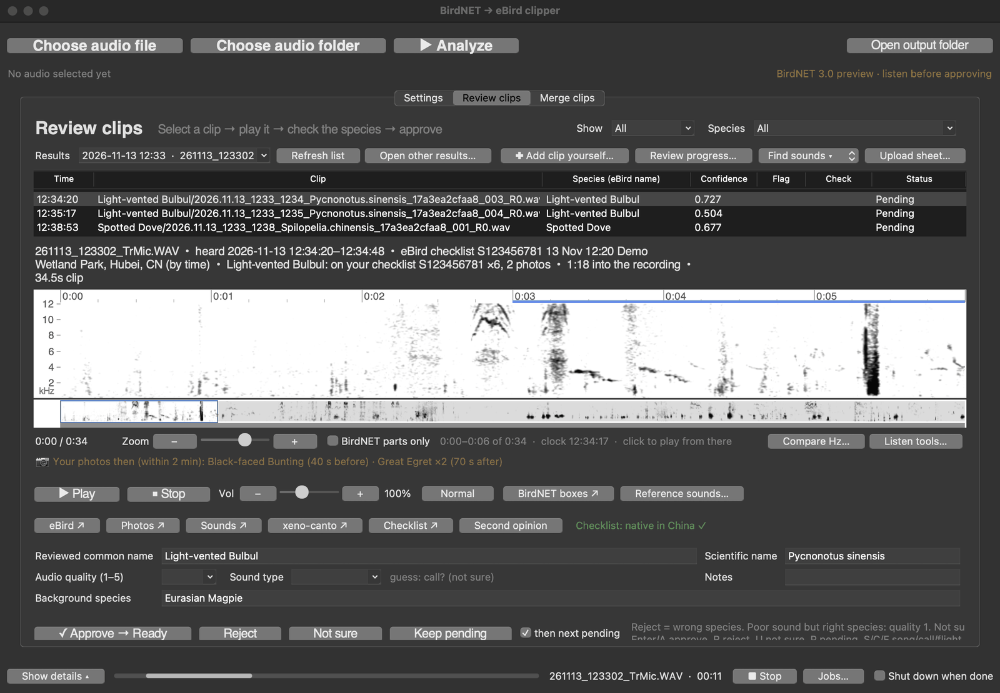

**Background species**
- คลิปที่ยังไม่ได้ตรวจ แอปเติมชนิดที่ BirdNET เจอในไฟล์เดียวกันช่วงที่ทับคลิปนี้ให้ (เช่น *Eurasian Magpie* ในภาพ)
- **ฟังแล้วลบชนิดที่ไม่ได้ยินจริง** (BirdNET อาจทายเสียงเดียวกันเป็นสองชนิด)
- คลิกช่อง = เลือกชนิดที่ BirdNET เจอเพิ่ม พร้อมคะแนนและจำนวนวินาทีที่ทับคลิป · พิมพ์หลัง `;` = ค้นจากรายชื่อ eBird
- ชนิดหลักของคลิปยังเป็นชนิดที่ BirdNET ทาย ถ้ายังได้ยินชนิดนั้น แม้อีกชนิดจะดังหรือร้องถี่กว่า
- ไฟล์ใน Ready ของคลิปที่มี Background species ขึ้นต้นด้วย `with-<ชนิด>__` เห็นได้ใน Finder

**ปุ่มตัดสิน**

| ฟังแล้ว | กด |
|---|---|
| ชนิดถูก เสียงดี | ให้ Audio quality 2–5 แล้ว **✓ Approve → Ready** |
| ชนิดถูก แต่เสียงไม่ดี | **Approve** ให้คุณภาพ **1** (ไม่ใช่ Reject) |
| เป็นอีกชนิดที่คุณรู้ว่าคืออะไร | แก้ช่อง **Reviewed common name** แล้ว Approve (แอปนับว่า BirdNET ทายผิด และไฟล์ใน Ready ใช้ชื่อใหม่) |
| ไม่ใช่ชนิดนี้ | **Reject** (ลบสำเนาใน Ready ถ้ามี) |
| เสียงไม่ชัดพอจะระบุชนิด | **Not sure** (ไม่เข้า Ready และไม่นับว่าถูกหรือผิด) |
| ยังไม่ตัดสินตอนนี้ | **Keep pending** |
| ได้ยินชนิดอื่นด้วย | ใส่ใน **Background species** แล้วตัดสินชนิดหลักตามปกติ |

> **Reject ใช้เมื่อชนิดผิดเท่านั้น** แอปใช้กติกานี้วัดความแม่นของ BirdNET และตัวกรองใน Review progress…

- **✓ Approve → Ready** ต้องมีชื่อสามัญ ชื่อวิทยาศาสตร์ และคะแนนคุณภาพ คลิปต้องไม่เกิน 500 MB (ขีดจำกัด eBird)
- ติ๊ก **then next pending** (ค่าเริ่มต้น) แอปเลือกคลิปที่ยัง Pending ถัดไปให้หลังกดตัดสิน ตรวจต่อเนื่องได้โดยไม่ต้องคลิก
- ตัดสินแล้วเปลี่ยนใจได้ เลือกคลิปแล้วกดปุ่มใหม่

### 7.6 ปุ่มลัด

คลิกตารางคลิปหรือภาพเสียงก่อน ใช้ได้ทั้งแป้นภาษาไทยและอังกฤษ (แอปดูปุ่มจริง)

| ปุ่ม | ทำอะไร |
|---|---|
| **1–5** | Audio quality |
| **Enter** หรือ **A** | Approve |
| **R** | Reject |
| **U** | Not sure |
| **P** | Keep pending |
| **S / C / F** | Sound type: Song / Call / Flight call |
| **Space** | เล่น / หยุด |
| **↑ / ↓** | คลิปก่อนหน้า / ถัดไป |
| **← / →** (บนภาพ) | เลื่อนภาพทีละหน้า |
| **− / +** (บนภาพ) | ย่อ / ขยายเวลา |

**ตรวจเร็วที่สุด**: เลือก Show = Pending › คลิกตาราง › Space ฟัง › กดเลขคุณภาพ › Enter › (แอปไปคลิปถัดไปเอง) › Space ฟัง › …

### 7.7 คลิปที่ควรระวังเป็นพิเศษ

- **ชื่อตาม eBird ต่างจาก BirdNET**: แอปเติมชื่อตาม eBird ให้ เช่น BirdNET เรียก *Black-throated Bushtit* = eBird *Black-throated Tit*
- **ชนิดที่ eBird แยกแล้ว** (*check the name*): เช่น Striated Heron ในจีน = Little Heron ให้แก้ชื่อก่อน Approve
- **นกหายากหรือนอกฤดู**: ฟังซ้ำ เทียบเสียงอ้างอิง และดูบรรทัด eBird
- **คะแนนต่ำ (ต่ำกว่า 0.65)**: จากที่ตรวจมา ID ผิดมักอยู่ช่วงนี้ ดู Second opinion ประกอบ

---

## 8. ฟังละเอียด: Listen tools (หน้าเสียง Prism)

ปุ่ม **Listen tools…** ใต้ภาพเสียง (และในหน้าต่างอื่นหลายหน้าต่าง) เปิดหน้าเสียงใหญ่ ใช้ฟังเจาะช่วงเวลาและย่านความถี่

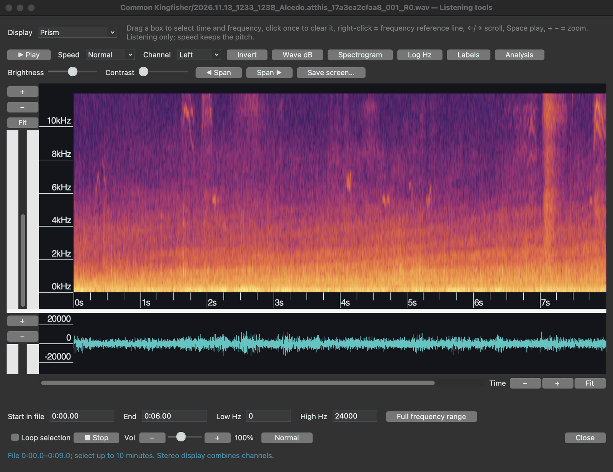

**แถบควบคุมด้านบน** (ขึ้นบรรทัดใหม่เองเมื่อหน้าต่างแคบ)

| ส่วน | ทำอะไร |
|---|---|
| **Display** | Prism (ค่าเริ่มต้น) หรือ Macaulay (ภาพแบบหน้า Review) |
| **▶ Play** | เล่นกรอบที่เลือก หรือจากขอบซ้ายของภาพ |
| **Speed** | Normal, 1/2, 3/4, 1.25, 1.5, 2 — เปลี่ยนความเร็วโดยเสียงไม่เพี้ยน |
| **Channel** | Left / Right / mix ดูและฟังทีละช่อง |
| **Invert** | สลับสีภาพ |
| **Wave dB** | สลับคลื่นเสียงด้านล่างระหว่างค่าตัวอย่างเสียงกับหน่วย dB |
| **Spectrogram** | ซ่อน/แสดงภาพความถี่ |
| **Log Hz** | แกนความถี่แบบ log (ดูเสียงต่ำได้ละเอียดขึ้น) |
| **Labels** | ป้ายชนิดที่ BirdNET ทายบนภาพ |
| **Analysis** | หน้าต่าง Prism Analysis: สเปกตรัมและค่าวัดของกรอบที่เลือก (dBmin/dBmax/dBmean, Fpmin/Fpmax/Fpmean/Fppeak) กด *Copy values* คัดลอกค่า |
| **Brightness / Contrast** | ปรับความสว่างและความคมของภาพ |
| **◀ Span / Span ▶** | เลื่อนไปช่วงก่อนหน้า/ถัดไป |
| **Save screen…** | บันทึกภาพหน้าจอนี้เป็นไฟล์ |

**ภาพ**
- ลากกรอบบนภาพ = เลือกช่วงเวลาและความถี่ คลิกครั้งเดียว = ยกเลิกกรอบ
- **คลิกขวา = เส้นอ้างอิงความถี่** ไว้เทียบความสูงของเสียง
- ปุ่ม **+ / − / Fit** ด้านซ้าย = ย่อขยายแกนความถี่, ปุ่ม **Time − / + / Fit** ด้านล่าง = ย่อขยายแกนเวลา
- ดับเบิลคลิกแกนเวลา = สลับเป็นเวลาจริง
- คีย์ลัด: ← / → เลื่อน, Space เล่น, + / − ย่อขยาย
- เส้นแดง = จุดที่กด MARK บนเครื่องอัด

**ด้านล่าง**
- **Start in file / End / Low Hz / High Hz** พิมพ์ช่วงเองได้ **Full frequency range** = กลับเต็มย่าน
- **Loop selection** วนฟังกรอบ, **■ Stop**, **Vol**
- เลือกได้ยาวสุด 10 นาทีต่อครั้ง เป็นการฟังอย่างเดียว ไม่แก้คลิปหรือไฟล์ต้นฉบับ

---

## 9. เทียบกับเสียงอ้างอิง: Compare Hz…

ปุ่ม **Compare Hz…** ใต้ภาพเสียง ใช้แยกชนิดที่เสียงคล้ายกัน เช่น Pale-legged กับ Sakhalin Leaf Warbler
หรือ Chestnut-flanked กับ Swinhoe's White-eye

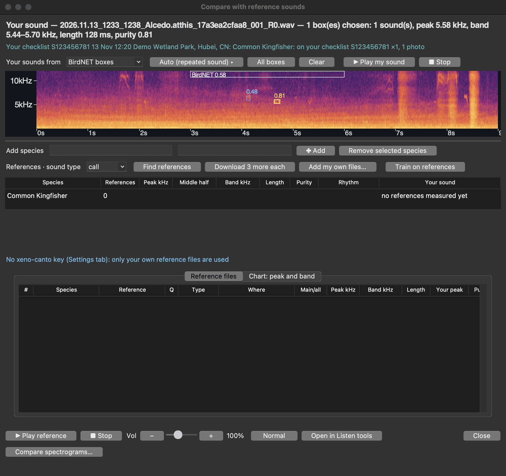

### 9.1 เลือกเสียงของคุณ (ภาพบน)

- **Your sounds from**: *BirdNET boxes* (กรอบเสียงที่ BirdNET เจอ) หรือ *Sound detector*
- **Auto (repeated sound) ▸** = แอปเลือกกลุ่มเสียงที่ร้องซ้ำให้ (กดซ้ำ = กลุ่มถัดไป)
- **All boxes** = ใช้ทุกกรอบ, **Clear** = ล้าง
- คลิกกรอบ = ใช้ / ไม่ใช้, **ลากบนภาพ = กรอบของคุณเอง**
- **▶ Play my sound** ฟังเฉพาะกรอบที่เลือก
- เลือกเฉพาะเสียงของนกตัวที่สนใจ ไม่ให้เสียงนกอื่นปน

### 9.2 เลือกชนิดที่จะเทียบ

- ช่อง **Add species** พิมพ์ชื่อแล้ว **✚ Add** เพิ่มชนิดที่คล้ายกัน, **Remove selected species** เอาออก
- **References · sound type**: เลือกประเภทเสียงอ้างอิง (song / call) ให้ตรงกับเสียงของคุณ
- **Find references** โหลดเสียงอ้างอิงจาก xeno-canto (ต้องมี key), **Download 3 more each** โหลดเพิ่มชนิดละ 3 ไฟล์
- **Add my own files…** ใช้ไฟล์อ้างอิงของคุณเอง (ไฟล์ชื่อแบบ `XC123 - Name - Genus species` เข้าชนิดเอง) ไฟล์ถูกคัดลอกเก็บใน `data/reference-sounds/`
- **Train on references** ฝึกตัวแยกชนิดจากเสียงอ้างอิงที่โหลดไว้ แล้วบอกว่าทายไฟล์ที่ไม่ได้ใช้ฝึกถูกกี่ไฟล์ ก่อนทายเสียงของคุณ

### 9.3 อ่านผล

ตารางเทียบแต่ละชนิดกับเสียงของคุณ:

| คอลัมน์ | ความหมาย |
|---|---|
| References | จำนวนไฟล์อ้างอิงที่วัดได้ |
| Peak kHz | ความถี่ที่ดังสุด |
| Middle half | ช่วงความถี่ครึ่งกลาง |
| Band kHz | ย่านเสียงต่ำสุด–สูงสุด |
| Length | ความยาวเสียงแต่ละครั้ง |
| Purity | ความใสของเสียง (สูง = หวีดใส, ต่ำ = แหบ) |
| Rhythm | จังหวะ: โน้ตต่อวินาที ความสม่ำเสมอ และการรัว (trill) |
| Your sound | ค่าของเสียงคุณเทียบกับชนิดนั้น |

- แอปสรุปว่า **Closer to …** (ใกล้ชนิดไหน) หรือ **Inconclusive** (ตัดสินไม่ได้)
- แต่ละชนิดควรมีเสียงอ้างอิงอย่างน้อย 5 ไฟล์จากผู้บันทึก 3 คน ถ้าน้อยกว่านี้ผลขึ้น *Provisional* (กด Find references ให้ครบ)
- แท็บ **Reference files** = รายการไฟล์อ้างอิง, **Chart: peak and band** = กราฟความถี่เทียบกัน
- ปุ่มล่าง: **▶ Play reference**, **■ Stop**, **Vol**, **Open in Listen tools**, **Compare spectrograms…**
- **ผลของตัวเทียบเป็นคำใบ้** ใช้ประกอบการฟัง ไม่ใช่การระบุชนิด

### 9.4 Compare spectrograms…

วางภาพเสียงของคุณเรียงกับแต่ละชนิด สเกลเวลาและความถี่เดียวกัน ดูรูปร่างเสียงของชนิดที่ความถี่ใกล้กันมาก

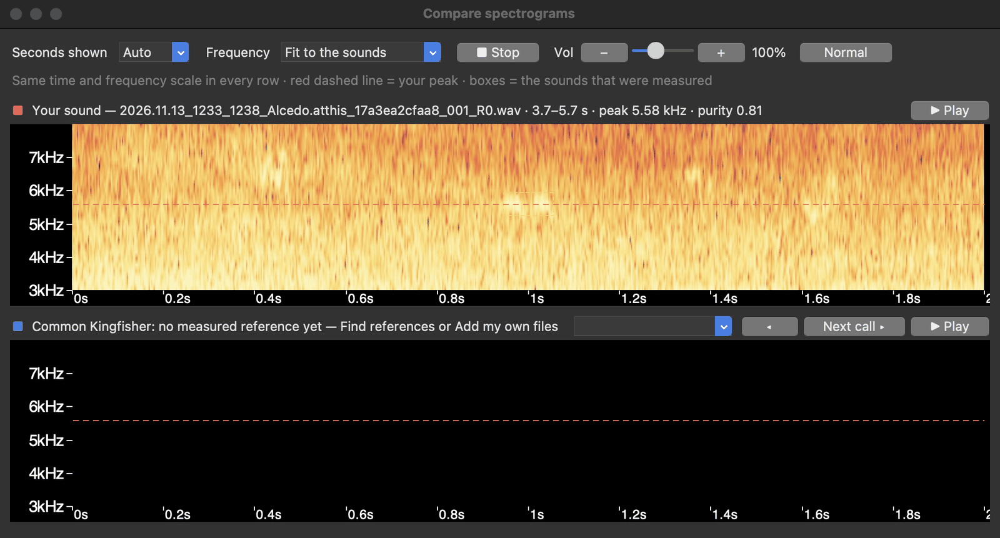

- **Seconds shown** = ความยาวที่แสดง, **Frequency** = ย่านความถี่ (Fit to the sounds = พอดีเสียง)
- แต่ละแถวมี **▶ Play** ฟังทีละแถว แถวชนิดอ้างอิงเลือกไฟล์ได้ และ **Next call ▸** ไปเสียงถัดไปในไฟล์

---

## 10. เพิ่มคลิปเอง: Add clip yourself…

ใช้กับเสียงที่ BirdNET ไม่เจอหรือได้คะแนนต่ำกว่าเกณฑ์ กด **✚ Add clip yourself…** ในแท็บ Review clips

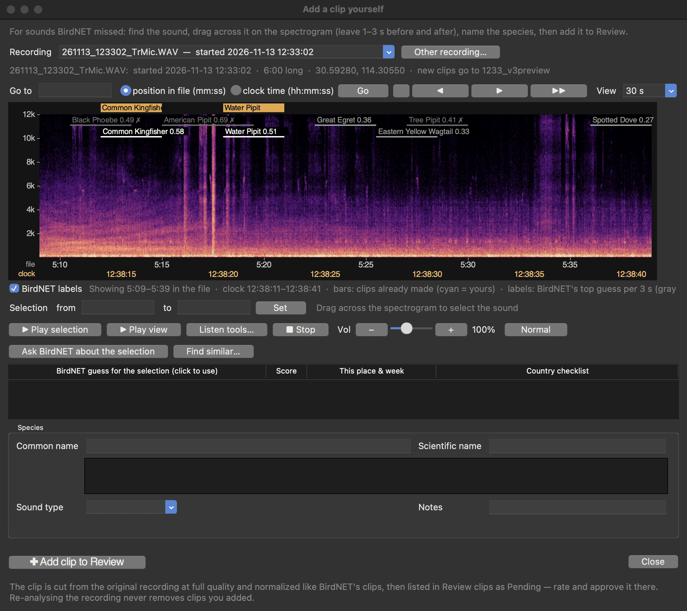

1. **Recording**: ไฟล์ต้นฉบับของผลชุดที่เปิดอยู่ (เริ่มที่ตำแหน่งของคลิปที่เลือกไว้)
   **Other recording…** = เปิดไฟล์อื่น ไฟล์ที่ยังไม่เคยวิเคราะห์ แอปอ่านวันเวลาและขอพิกัด แล้วกด **Use these details**
2. **Go to**: พิมพ์ตำแหน่งในไฟล์ (`5:04`) หรือเลือก *clock time* แล้วพิมพ์เวลาจริง (`12:38:14`) แล้วกด **Go**
   - ◀◀ ▶▶ เลื่อนทีละหน้าจอ, ◀ ▶ เลื่อนทีละ ¼ หน้าจอ, **View** = ความยาวที่เห็น (10–60 วินาที)
   - แกนเวลามี 2 แถว: ตำแหน่งในไฟล์ (เทา) และเวลาจริง (เหลือง)
   - แถบสีเหนือภาพ = คลิปที่มีอยู่แล้ว (เหลือง Pending, เขียว Approved, เทา Rejected, ฟ้า = ที่เพิ่มเอง)
   - **BirdNET labels** (ติ๊ก): ป้ายชนิดที่ BirdNET ทายทุก 3 วินาที ขาว = ถึงเกณฑ์, เทา = ต่ำกว่าเกณฑ์, ✗ = ไม่ควรพบที่นี่, เขียวอมฟ้า = ไม่ใช่นก
3. **ลากบนภาพ** เลือกช่วงเสียง (เผื่อก่อน/หลัง 1–3 วินาที) หรือพิมพ์ในช่อง **Selection** แล้วกด **Set**
   - **▶ Play selection** / **▶ Play view** / **Listen tools…** / **■ Stop**
4. **Ask BirdNET about the selection**: BirdNET ฟังเฉพาะช่วงนั้นด้วยเกณฑ์ต่ำมาก แล้วแสดงชนิดที่น่าจะเป็น
   พร้อมบอกว่าควรพบที่นี่สัปดาห์นี้ไหม (*This place & week*) และสถานะใน checklist ของประเทศ — คลิกชื่อเพื่อใช้ (เป็นคำใบ้)
   **Find similar…** = หาเสียงที่คล้ายช่วงนี้ (ข้อ 11.1)
5. **Species**: พิมพ์บางส่วนของชื่อแล้วเลือกจากรายการ เลือก **Sound type** และใส่ **Notes**
6. **✚ Add clip to Review**: แอปตัดคลิปจากไฟล์ต้นฉบับแบบเดียวกับคลิปของ BirdNET แล้วเลือกคลิปใหม่ในแท็บ Review ให้ ตรวจและ Approve ตามปกติ

- คลิปที่เพิ่มเองชื่อไฟล์มี `_M001_` และขึ้น *added by you* ในตาราง
- **การวิเคราะห์ใหม่ (รวม force redo) ไม่ลบ ไม่แทนที่ และไม่ล้างผลตรวจของคลิปที่เพิ่มเอง**
- ชนิดที่ไม่อยู่ใน checklist ของประเทศ แอปถามยืนยันก่อนเพิ่ม

---

## 11. ค้นเสียงเพิ่ม: เมนู Find sounds ▾

เครื่องมือในเมนูนี้ใช้ **ดัชนีเสียง** ที่แอปสร้างเองเบื้องหลังเมื่อเปิดผลชุดใน Review (BirdNET ฟังทั้งไฟล์ทีละ 3 วินาทีแล้วเก็บ "ลายนิ้วมือเสียง" ไว้)
ถ้าดัชนียังไม่เสร็จ แอปทำให้ก่อนเปิดหน้าต่าง

**ส่วนที่ทุกหน้าต่างในเมนูนี้มีเหมือนกัน** (ครึ่งล่างของหน้าต่าง)
- ภาพเสียงของแถวที่เลือก พร้อม Zoom, BirdNET parts only, Compare Hz…, Listen tools…
- **▶ Play / ■ Stop / Vol / Normal**
- **Open in Add clip window…** = เปิดช่วงนั้นในหน้าต่าง Add clip เพื่อปรับช่วงเองก่อนเพิ่ม
- **Select strong** (เลือกแถวที่คะแนนสูง) / **Select all** — เลือกหลายแถวด้วย Shift / Cmd-คลิกได้
- **Add selected as clips of** [ชื่อสามัญ] [ชื่อวิทยาศาสตร์] + **Sound type** › **✚ Add selected** = เพิ่มเป็นคลิป Pending
  (ตัดจากไฟล์ต้นฉบับเผื่อหน้าหลัง 1.5 วินาที เสียงที่มีคลิปของชนิดนั้นทับอยู่แล้วจะถูกข้าม)
- คอลัมน์ **Clips already there**: เทา = มีคลิปของชนิดนี้แล้ว

### 11.1 Similar to the selected clip…

หาเสียงที่คล้ายคลิปที่เลือก เช่น เจอนกหัวขวานหนึ่งครั้ง อยากรู้ว่าร้องที่อื่นในไฟล์อีกไหม

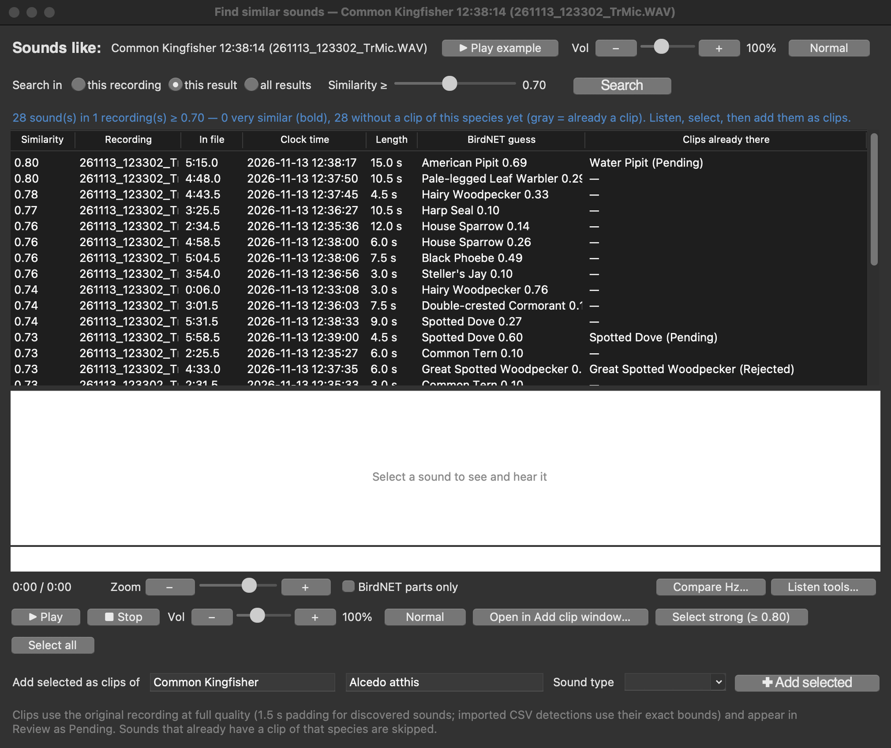

- **Sounds like** = ตัวอย่าง (ช่วงที่ BirdNET ได้ยินในคลิป) **▶ Play example** ฟังตัวอย่าง
- **Search in**: this recording / this result / all results
- **Similarity ≥** (ค่าเริ่มต้น 0.70) แล้วกด **Search**
- ผลเรียงจากคล้ายที่สุด **ตัวหนา** = คล้ายมาก (0.80 ขึ้นไป) คอลัมน์ *BirdNET guess* = ชนิดที่ BirdNET ทายตรงนั้น

### 11.2 Sound groups in this result…

จัดกลุ่มเสียงที่ BirdNET ยังไม่ได้ตัดเป็นคลิป ฟังทีละกลุ่ม แล้วตั้งชื่อทั้งกลุ่ม

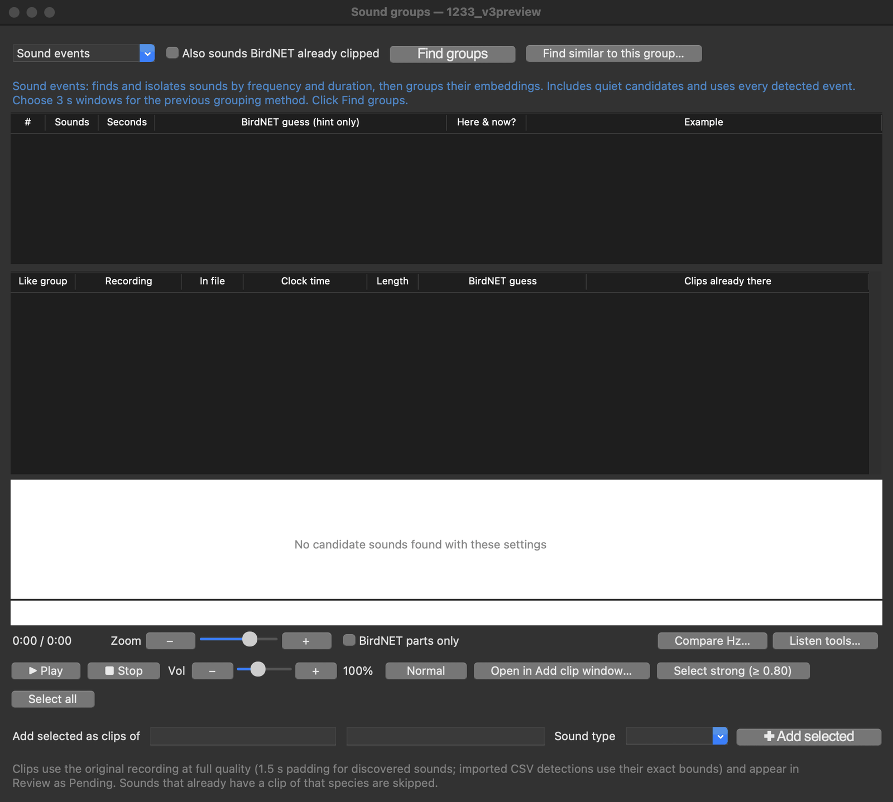

- โหมด: **Sound events** (แยกตัวเสียงก่อนจัดกลุ่ม) หรือ **3 s windows** (วิธีเดิม ทีละ 3 วินาที)
- **Also sounds BirdNET already clipped** = รวมเสียงที่มีคลิปแล้วด้วย
- **Find groups** เริ่มจัดกลุ่ม ตารางบน = กลุ่ม (กลุ่มใหญ่ = เสียงที่ร้องซ้ำ ก่อน) พร้อม *BirdNET guess* และ *Here & now?* (ควรพบที่จุดและสัปดาห์นั้นไหม)
- เลือกกลุ่ม = ตารางล่างแสดงเสียงในกลุ่ม (คล้ายจุดกลางกลุ่มที่สุดก่อน)
- **Find similar to this group…** = ค้นต่อในทุกผลชุด

### 11.3 Your recognizers…

ฝึก "ตัวจำแนก" ของคุณเองต่อชนิด จากคลิปที่คุณ Approve แล้วใช้หาเสียงชนิดนั้นเพิ่ม

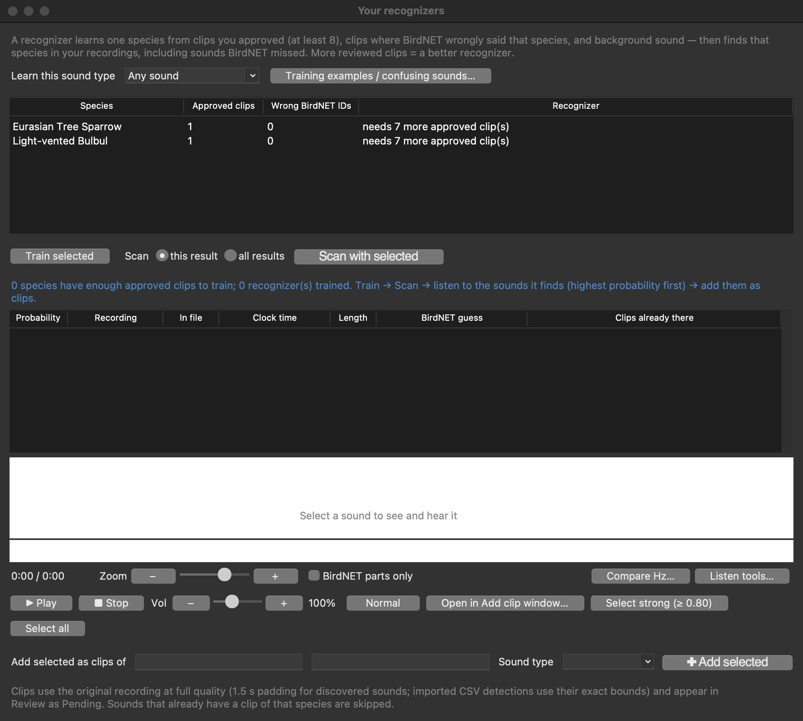

- ตารางบอก: Species, **Approved clips**, **Wrong BirdNET IDs** (คลิปที่ BirdNET ทายเป็นชนิดนั้นแต่ผิด ซึ่งช่วยมาก), สถานะ Recognizer
  (*needs 7 more approved clip(s)*, *ready to train*, หรือ *finds 62% at 82% precision*)
- ต้องมีคลิปที่ Approve ชนิดละ **8 คลิปขึ้นไป**
- **Learn this sound type**: Any sound หรือเฉพาะ Song / Call / ประเภทอื่น
- **Training examples / confusing sounds…** = ดูตัวอย่างบวก/ลบที่ใช้ฝึก
- **Train selected** › **Scan** (this result / all results) › **Scan with selected** › ฟังผล › เพิ่มเป็นคลิป
- ตรวจคลิปมากขึ้น ตัวจำแนกยิ่งดี ฝึกใหม่เมื่อไรก็ได้

### 11.4 Near misses in this result…

ชนิดที่ BirdNET เกือบเจอ (คะแนนต่ำกว่า min_conf) แต่ยังไม่มีคลิป พร้อมผลฟังซ้ำแบบวางหน้าต่างตรงเสียง

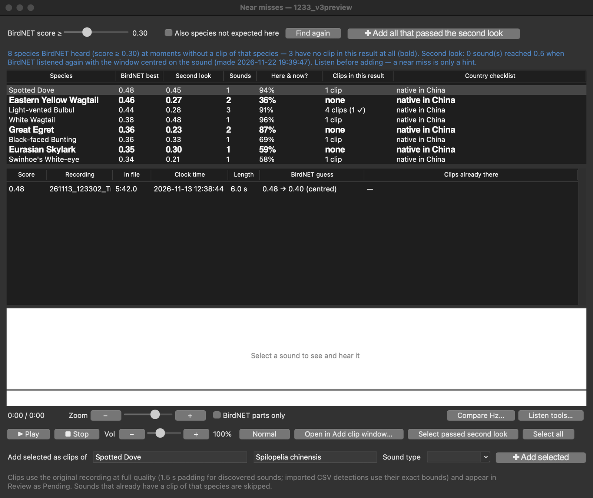

- **BirdNET score ≥** (ค่าเริ่มต้น 0.30), **Also species not expected here** = รวมชนิดที่ไม่ควรพบที่นี่, **Find again** ค้นใหม่
- ตารางบน: Species, BirdNET best, **Second look** (คะแนนเมื่อฟังซ้ำ), Sounds, Here & now?, Clips in this result, Country checklist
  **ตัวหนา** = ชนิดที่ยังไม่มีคลิปในผลชุดนี้
- **✚ Add all that passed the second look** = เพิ่มทุกเสียงที่ผ่านการฟังซ้ำ, **Select passed second look** = เลือกเฉพาะที่ผ่าน
- ใช้กับผลที่วิเคราะห์ไว้ก่อนเปิด Second look ได้ด้วย

### 11.5 Expected species here…

ชนิดที่ควรพบที่จุดและสัปดาห์นั้นตามโมเดลพื้นที่ของ BirdNET เทียบกับคลิปที่มี

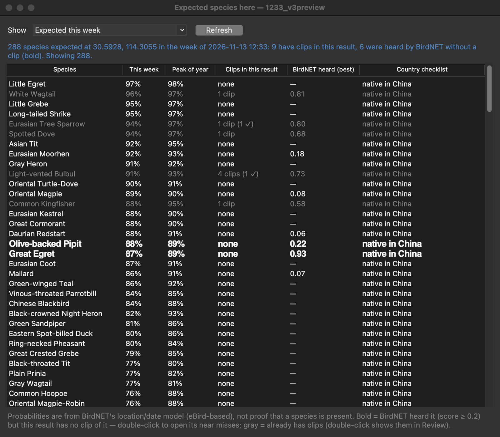

- **Show**: Expected this week หรือทั้งหมด, **Refresh**
- คอลัมน์: This week (% โอกาสพบสัปดาห์นี้), Peak of year, Clips in this result, BirdNET heard (best), Country checklist
- **ตัวหนา** = BirdNET ได้ยินแต่ยังไม่มีคลิป (ควรลองฟัง) · เทา = มีคลิปแล้ว
- ดับเบิลคลิกชนิด = เปิดใน Near misses (ถ้า BirdNET ได้ยิน) หรือแสดงคลิปของชนิดนั้นใน Review
- โอกาสพบเป็นค่าจากโมเดล ไม่ได้พิสูจน์ว่ามีนกชนิดนั้นจริง

### 11.6 Recorder flags… (ปุ่ม MARK บนเครื่องอัด Zoom)

กดปุ่ม MARK ตอนได้ยินนกที่สนใจ แอปอ่านจุดนั้นจากไฟล์ WAV เอง (ใช้กับผลเก่าได้โดยไม่ต้องวิเคราะห์ใหม่)

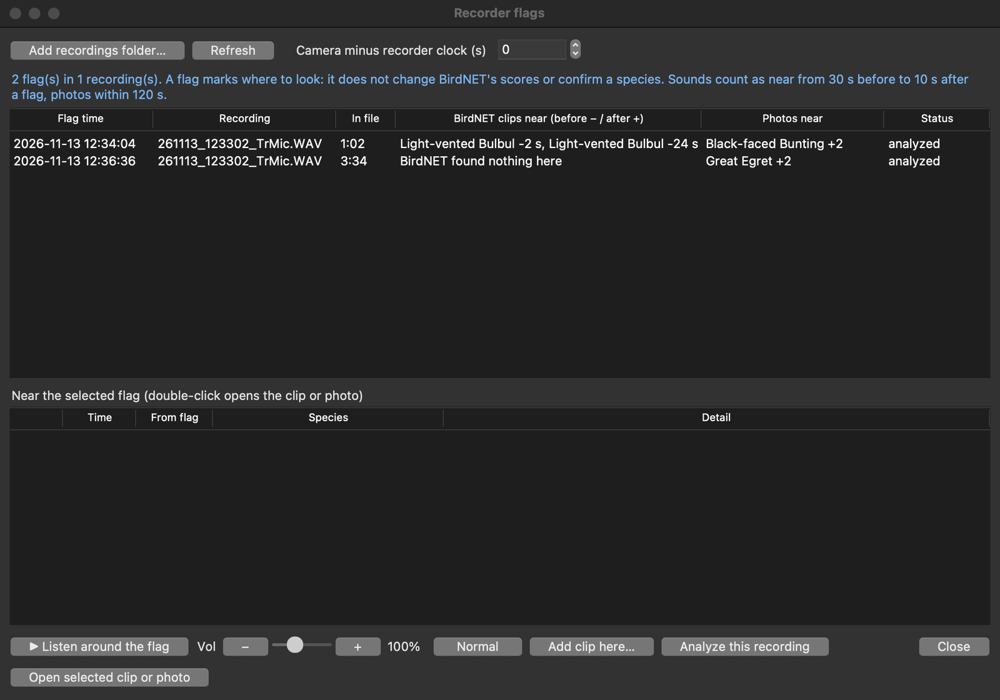

- ตารางบน = flag ทุกจุดจากผลทุกชุด คอลัมน์ *BirdNET clips near* บอกคลิปที่อยู่ใกล้ เช่น *Light-vented Bulbul −2 s*
- **Add recordings folder…** = เพิ่มโฟลเดอร์เสียงอื่น (ไฟล์ที่ยังไม่ได้วิเคราะห์ก็เห็น), **Refresh**
- **Camera minus recorder clock (s)**: นาฬิกากล้องเร็วกว่าเครื่องอัดกี่วินาที (ช้ากว่าใส่ค่าลบ) ใช้กับบรรทัดรูปในหน้า Review ด้วย
- ตารางล่าง = คลิปใกล้ flag ที่เลือก ดับเบิลคลิกเปิดคลิปใน Review
- **▶ Listen around the flag** = เปิด Listen tools ช่วง 30 วินาทีก่อนถึง 10 วินาทีหลัง flag
- **Add clip here…** = เปิดหน้าต่าง Add clip ตรงจุดนั้น (ใช้เมื่อ BirdNET ไม่เจออะไร)
- **Analyze this recording** = วิเคราะห์ไฟล์ที่ยังไม่ได้ทำ
- ในแท็บ Review: คอลัมน์ **Flag** (`⚑ +4 s` = คลิปอยู่หลัง flag 4 วินาที, `⚑ in clip` = flag อยู่ในคลิป), **Show › Near a flag** และเส้นแดงบนภาพเสียง
- คนมักกดหลังได้ยินเสียง แอปจึงนับคลิปที่อยู่ก่อน flag ไม่เกิน 30 วินาทีหรือหลัง flag ไม่เกิน 10 วินาทีว่า "ใกล้"
- flag เป็นแค่จุดให้กลับมาดู **ไม่เปลี่ยนคะแนนและไม่ยืนยันชนิด** (เครื่องใส่ MARK เองตอน Pause แล้วอัดต่อด้วย)

### 11.7 Find sound events (without BirdNET)…

สแกนหาเหตุการณ์เสียงตามย่านความถี่ ความยาว และความดังเหนือพื้นหลัง โดยไม่ใช้ BirdNET
ใช้กับไฟล์ที่ยังไม่เคยวิเคราะห์ได้ เหมาะกับเสียงที่ BirdNET ไม่รู้จัก

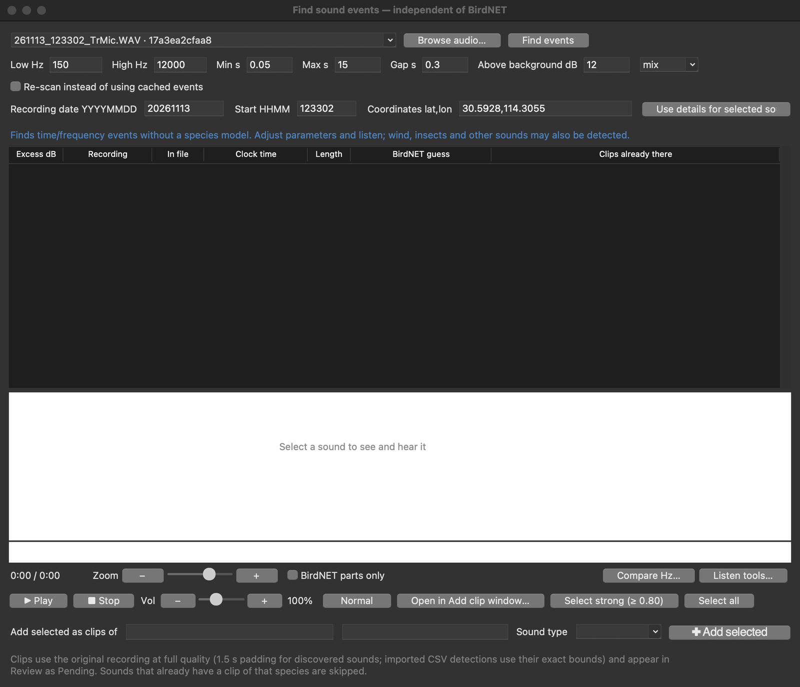

- เลือกไฟล์ (หรือ **Browse audio…**) แล้วตั้ง **Low Hz / High Hz** (ย่านความถี่), **Min s / Max s** (ความยาวเสียง), **Gap s** (ช่องว่างที่ถือว่าเป็นเสียงเดียวกัน), **Above background dB**, ช่องเสียง
- **Find events** เริ่มสแกน, **Re-scan instead of using cached events** = สแกนใหม่ไม่ใช้ผลเดิม
- ไฟล์ที่ยังไม่เคยวิเคราะห์: กรอก **Recording date / Start HHMM / Coordinates** แล้ว **Use details for selected source**
- ฟังแล้วเลือกชนิด › ✚ Add selected เข้า Pending

### 11.8 Import detections CSV…

นำเข้าตำแหน่งเสียงจากโปรแกรมอื่น (CSV ที่มีชื่อไฟล์ เวลาเริ่ม และความยาว เช่น `cluster.csv`)

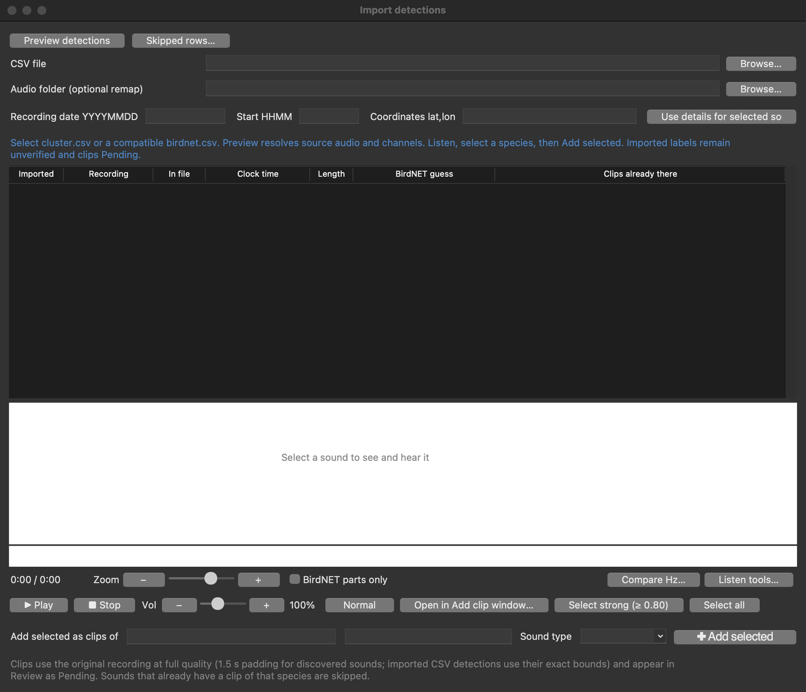

1. **CSV file › Browse…** เลือกไฟล์
2. **Audio folder (optional remap) › Browse…** ถ้าไฟล์เสียงย้ายที่ไปแล้ว
3. กรอกวันเวลาและพิกัดของไฟล์ที่ยังไม่เคยวิเคราะห์ แล้ว **Use details for selected source**
4. **Preview detections** › ฟัง › เลือกชนิด › ✚ Add selected
- ชื่อชนิดใน CSV เป็นแค่คำใบ้ คลิปเข้า Pending เสมอ · CHANNEL 0 = ซ้าย, 1 = ขวา · **Skipped rows…** = แถวที่อ่านไม่ได้

---

## 12. ดูความคืบหน้าและความแม่น: Review progress…

รวมผลทุกชุดจากทุกโฟลเดอร์ บอกว่าตรวจไปเท่าไร และตัวกรองไหนช่วยได้จริง

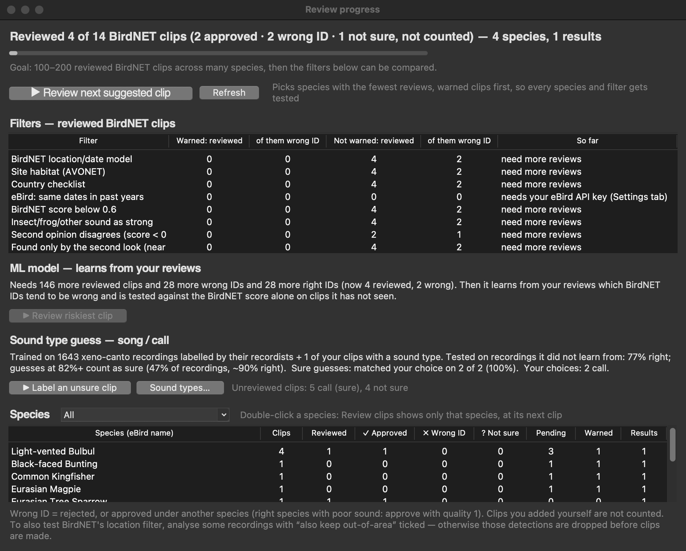

| ส่วน | บอกอะไร |
|---|---|
| หัวหน้าต่าง | ตรวจไปกี่คลิปของ BirdNET แยก approved / wrong ID / not sure เป้าคือ 100–200 คลิปหลาย ๆ ชนิด |
| **▶ Review next suggested clip** | ไปคลิปถัดไปที่ควรตรวจ (ชนิดที่ตรวจน้อย คลิปที่มีคำเตือนก่อน) |
| **Filters — reviewed BirdNET clips** | แต่ละตัวกรอง (โมเดลพื้นที่, ถิ่นอาศัย, checklist ประเทศ, eBird ปีก่อน ๆ, คะแนนต่ำกว่า 0.6, เสียงแมลง/กบ, Second opinion, Second look) เตือนคลิปที่ตรวจแล้วกี่คลิป และในนั้นผิดกี่คลิป เมื่อข้อมูลพอ (ฝั่งละ 10 คลิปขึ้นไป) จะสรุปว่าตัวกรองจับ ID ผิดได้กี่ % |
| **ML model — learns from your reviews** | โมเดลในเครื่องที่เรียนจากผลตรวจของคุณว่า ID แบบไหนของ BirdNET มักผิด **▶ Review riskiest clip** = ไปคลิปที่เสี่ยงที่สุด |
| **Sound type guess — song / call** | ความแม่นของคำเดา song/call เทียบกับที่คุณเลือก **▶ Label an unsure clip**, **Sound types…** (ข้อ 12.1) |
| **Species** | ตารางต่อชนิด: Clips, Reviewed, ✓ Approved, ✗ Wrong ID, ? Not sure, Pending, Warned, Results — **ดับเบิลคลิกชนิด = กรองแท็บ Review เฉพาะชนิดนั้น** |

**ID ถูก** = Approve ด้วยชนิดเดียวกับ BirdNET (คะแนนคุณภาพเท่าไรก็ได้) · **ID ผิด** = Reject หรือ Approve หลังแก้ชนิด · Not sure ไม่นับ
นี่คือเหตุผลที่ต้อง Approve คะแนน 1 แทน Reject เมื่อชนิดถูกแต่เสียงไม่ดี

### 12.1 Sound types…

ตรวจคำเดา song / call ของแอปทีละคลิป ช่วยให้คำเดาแม่นขึ้น

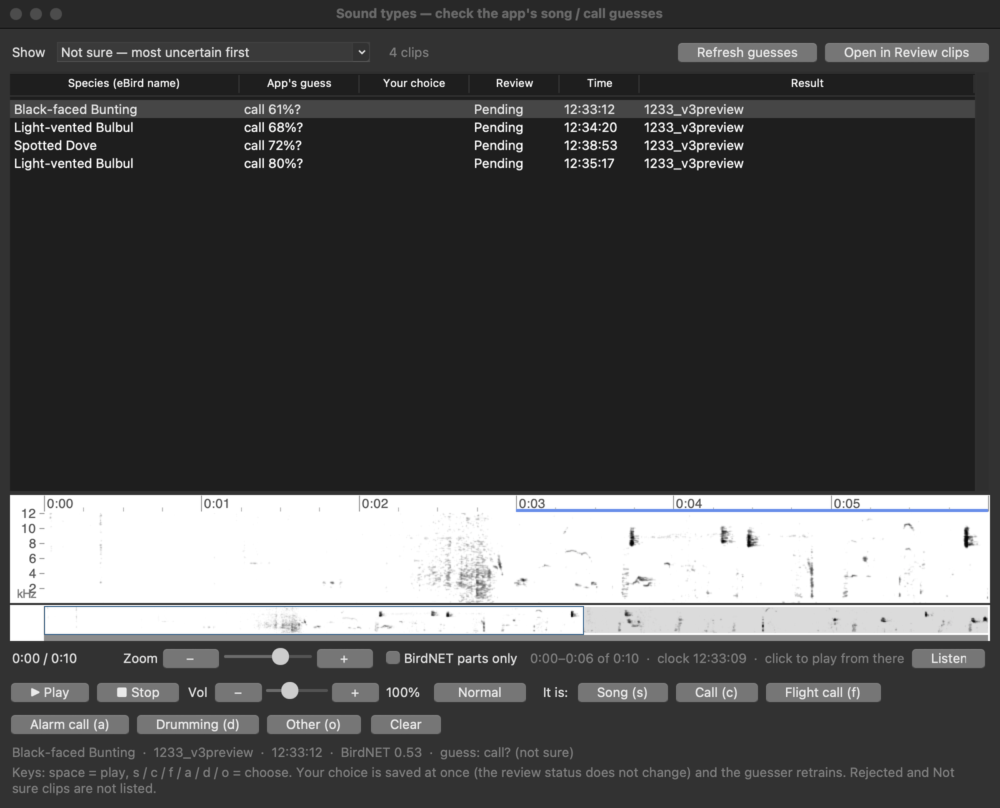

- **Show**: Not sure — most uncertain first (ค่าเริ่มต้น) หรืออื่น ๆ
- เลือกแถว › ฟัง › **It is:** Song (s) / Call (c) / Flight call (f) / Alarm call (a) / Drumming (d) / Other (o) / Clear
- คีย์ลัด: Space เล่น, ↑/↓ เลื่อนแถว, s/c/f/a/d/o เลือกประเภท
- สิ่งที่เลือกบันทึกเป็น Sound type ของคลิป (ไม่เปลี่ยนสถานะตรวจ) และแอปฝึกตัวเดาใหม่
- **Refresh guesses** เดาใหม่, **Open in Review clips** เปิดคลิปในแท็บ Review

---

## 13. อัปโหลดขึ้น eBird / Macaulay Library

### 13.1 โฟลเดอร์ Ready

คลิปที่ Approve ถูกคัดลอกไปที่ `<โฟลเดอร์ผลของวัน>/Ready/<checklist>/<ชนิด>/` (คลิปต้นฉบับในโฟลเดอร์ผลยังอยู่)

ตัวอย่างจริงจากข้อมูลตัวอย่าง:

```
20261113/Sounds/Done/2026.11.13/
├── Ready/
│   ├── 1220 Demo Wetland Park S123456781/       ← เวลาเริ่ม checklist, ชื่อสถานที่, รหัส checklist
│   │   ├── Eurasian Tree Sparrow/
│   │   │   └── 2026.11.13_1233_v3preview_bee3758f221d_Passer.montanus_Call_R3.wav
│   │   └── Light-vented Bulbul/
│   │       └── 2026.11.13_1233_v3preview_337829787b36_Pycnonotus.sinensis_Call_R4.wav
│   └── upload-sheet.csv                         ← สร้างเมื่อกด Upload sheet…
└── 1233_v3preview/                              ← ผลวิเคราะห์ของไฟล์ที่เริ่มอัด 12:33
    ├── summary.xlsx                             ← หนึ่งแถวต่อคลิป รวมผลตรวจของคุณ
    ├── Common Kingfisher/ …                     ← คลิปทั้งหมดแยกตามชนิด (.wav + ภาพ .png)
    └── Light-vented Bulbul/ …
```

**อ่านชื่อไฟล์ใน Ready**: `<วัน>_<เวลาเริ่มอัด>_<โมเดล>_<รหัสคลิป>_<Genus.species>_<ประเภทเสียง>_R<คุณภาพ>.wav`
- `_Call` = Sound type ที่เลือก (ไม่เลือก = ไม่มีส่วนนี้)
- `_R3` = Audio quality 3 ใช้กรอก Rating ตอนอัปโหลด
- ขึ้นต้นด้วย `with-<ชนิด>__` = มี Background species ติดมา (เกิน 3 ชนิดต่อท้าย `_and-2-more`) เรียงรวมกันท้ายโฟลเดอร์ชนิด
- วันที่ไม่มี Field log ไม่มีชั้น checklist: `Ready/<ชนิด>/` · ไฟล์ที่เลือก No checklist อยู่ใน `Ready/No checklist/`
- เปลี่ยน checklist ทีหลัง: ปิดหน้าต่าง Match recordings แล้วแอปย้ายให้ (ข้อ 5.2)
- เปิดโฟลเดอร์จากปุ่ม **Open output folder**

### 13.2 Upload sheet…

กด **Upload sheet…** ในแท็บ Review clips แอปเขียน `Ready/upload-sheet.csv` ของวันที่เปิดอยู่ แล้วเปิดให้ดูคู่กับหน้า eBird
**กดใหม่ทุกครั้งที่ตรวจเพิ่ม** (แอปไม่เขียนไฟล์นี้เอง)

ตัวอย่างจากข้อมูลตัวอย่าง:

| Checklist | Species | Scientific name | Time | Quality | Sound type | Additional species | Add to checklist first | BirdNET also heard | File |
|---|---|---|---|---|---|---|---|---|---|
| S123456781 | Eurasian Tree Sparrow | Passer montanus | 12:37:03 | 3 | Call | | | | …Passer.montanus_Call_R3.wav |
| S123456781 | Light-vented Bulbul | Pycnonotus sinensis | 12:33:36 | 4 | Call | | | | …Pycnonotus.sinensis_Call_R4.wav |

| คอลัมน์ | ใช้ตอนอัปโหลด |
|---|---|
| **Checklist** | อัปโหลดทีละ checklist ตามคอลัมน์นี้ (รายการเรียงตามคอลัมน์นี้แล้ว) |
| **Species, Scientific name, Time, File** | ไฟล์นี้ลงแถวชนิดไหน |
| **Quality, Sound type, Notes** | Rating, แท็กประเภทเสียง และหมายเหตุ |
| **Additional species** | Background species ที่คุณบันทึก ใส่ช่อง *Additional Species* ใน Manage Media |
| **Add to checklist first** | ชนิดที่ยังไม่อยู่ใน checklist (ทั้งชนิดหลักและ Background) eBird ให้เลือก Additional Species ได้เฉพาะชนิดที่อยู่ใน checklist แล้ว จึงต้องเพิ่มก่อนด้วย *Edit Species List* (จำนวนใส่ X ได้) |
| **BirdNET also heard** | ชนิดที่ BirdNET เจอในคลิปแต่คุณยังไม่ได้ยืนยัน **ฟังก่อน** ถ้าได้ยินจริงให้เพิ่มใน Background species แล้วกด Upload sheet… ใหม่ |

### 13.3 ขั้นตอนบน eBird

1. เปิด checklist บน eBird (ปุ่ม **Checklist ↗** ในหน้า Review พาไปได้)
2. ถ้าคอลัมน์ *Add to checklist first* มีชนิด ให้เพิ่มชนิดนั้นใน checklist ก่อน (*Edit Species List*)
3. ไปที่ **Manage Media** แล้วลากไฟล์จาก `Ready/<checklist>/<ชนิด>/` ไปที่แถวชนิดนั้น
4. ใส่ **Rating** ตามเลข `R` ในชื่อไฟล์ เลือกประเภทเสียงตามชื่อไฟล์ และใส่ **Additional Species** ตาม Upload sheet
5. ทำจนครบทุกชนิด แล้วไป checklist ถัดไป

- eBird แนะนำ: ชนิดที่เสียงเบาให้ใส่เป็นเสียงพื้นหลัง ส่วนชนิดที่ชัดทั้งคู่ให้อัปโหลดไว้ทั้งสองชนิด
- eBird รับไฟล์ไม่เกิน 500 MB ต่อไฟล์ (แอปตรวจให้ตอน Approve)

---

## 14. รวมคลิป: แท็บ Merge clips

ถ้ามีหลายคลิปของ **นกตัวเดียวกัน** รวมเป็นไฟล์เดียวก่อนอัปโหลดได้ (ตามแนวทางของ eBird)
BirdNET บอกได้แค่ชนิด ไม่บอกว่าเป็นตัวเดียวกันไหม ฟังยืนยันเองก่อน

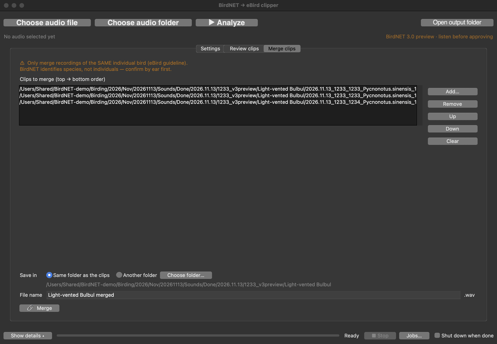

1. **Add…** เลือกคลิป (เลือกหลายไฟล์พร้อมกันได้) **Remove** เอาออก **Clear** ล้างทั้งหมด
2. เรียงลำดับด้วย **Up / Down** (บนลงล่าง = ลำดับในไฟล์ที่รวม)
3. **Save in**: *Same folder as the clips* (ข้างคลิปแรกในรายการ) หรือ *Another folder* + **Choose folder…**
4. **File name**: แอปเติมชื่อนกจากโฟลเดอร์ชนิดให้ เช่น `Light-vented Bulbul merged` แก้เองได้ ชื่อซ้ำจะต่อท้าย 2, 3, … ไม่ทับไฟล์เดิม
5. กด **🔗 Merge** แอปตัดเงียบหัวท้ายแต่ละคลิป คั่นด้วยเงียบ 1 วินาที และปรับระดับเสียงเป็น −3 dBFS

- คลิปต่างชนิดในรายการเดียว แอปเตือนก่อนรวม
- ไฟล์ที่ไม่ได้มาจากแอปใช้ชื่อไฟล์แรกแทนชื่อนก
- ไฟล์ที่รวมแล้วใน Ready ย้ายตามคลิปไปโฟลเดอร์ checklist ใหม่ ถ้าคลิปทั้งหมดไป checklist เดียวกัน

---

## 15. งานที่แอปทำให้เองเบื้องหลัง

| งาน | เกิดเมื่อ | ทำอะไร |
|---|---|---|
| **Auto-checks** | เปิดผลชุดในแท็บ Review | หาเสียงแมลง กบ หรือสัตว์อื่นที่ดังแข่งกับนก · ทำ Second opinion ให้คลิปคะแนน BirdNET ต่ำกว่า 0.65 · เก็บข้อมูลและโหลดเสียงอ้างอิง song/call เพื่อให้คำเดา Sound type แม่นขึ้น — ผลขึ้นในช่อง Check |
| **Sound index** | เปิดผลชุดในแท็บ Review | สร้างดัชนีเสียงของไฟล์ต้นฉบับ (ใช้กับ Find sounds และ Your recognizers) ครั้งเดียวต่อไฟล์ |
| **Ready sort** | ปิดหน้าต่าง Match recordings | ย้ายคลิปใน Ready ให้ตรง checklist |

- งานเบื้องหลัง **หลีกทางให้งานที่คุณสั่งเสมอ** และปิดแอประหว่างทำได้โดยไม่ถาม เปิดครั้งหน้าทำต่อจากที่ค้าง
- **เน็ตช้า**: ถ้าโหลดเสียงอ้างอิงจาก xeno-canto ได้ช้ากว่า 50 KB/s ติดกัน 20 วินาที งาน Auto-checks หยุดโหลดในรอบนั้น
  ทำส่วนที่ไม่ต้องใช้เน็ตให้เสร็จ แล้วรอรอบหน้า แถบสถานะขึ้น *xeno-canto was slow* (งานที่คุณสั่งเองยังโหลดต่อแม้ช้า)
- Auto-checks ไม่เขียนลง summary.xlsx (เก็บผลในแคชของแอป) จึงไม่ชนกับผลตรวจที่คุณกำลังบันทึก

---

## 16. ข้อมูลของคุณ การย้ายไฟล์ และการส่งให้เพื่อน

### 16.1 ข้อมูลของแอป: โฟลเดอร์ `data/` (ในโฟลเดอร์โปรแกรม)

| อยู่ที่ | คืออะไร |
|---|---|
| `data/settings.json` | การตั้งค่าและ API key **ห้ามส่งให้ใคร** |
| `data/field-logs.json` | checklist และการจับคู่ไฟล์เสียงกับ checklist ของคุณ |
| `data/analysis-presets.json` | ชุดตั้งค่า (อาจมีพิกัด) |
| `data/reference-sounds/` | ไฟล์อ้างอิงที่คุณเพิ่มเองในตัวเทียบเสียง |
| `data/birdnet/` | โมเดล BirdNET |
| `data/cache/` | เสียงอ้างอิงที่โหลดไว้ ดัชนีเสียง ตัวจำแนกที่ฝึกแล้ว และผล Auto-checks — ลบได้ แต่แอปต้องโหลดหรือคำนวณใหม่ |

**ผลตรวจของคุณ** (Approve / Reject / คะแนน / ประเภทเสียง / Background species) อยู่ในไฟล์ `summary.xlsx` ของแต่ละผลชุด
ไม่ได้อยู่ใน `data/` — **สำรองทั้งโฟลเดอร์ Birding (หรือ `~/BirdNET_eBird`) และ `data/` ไว้**

### 16.2 ย้ายไฟล์เสียงไปฮาร์ดดิสก์ภายนอก

1. ปิดแอปก่อนย้าย
2. ย้ายทั้งโครงสร้าง `<ปี>/<เดือน>/<วัน>` อย่าแยก `Sounds/Done` ออกจาก `Sounds/Raw`
3. อย่าย้ายโฟลเดอร์โปรแกรมหรือ `data/`
4. เปิดแอป แท็บ **Review clips** › **Open other results…** แล้วเลือก `summary.xlsx` ใน `Sounds/Done` ของแต่ละวันบนฮาร์ดดิสก์
   ทำครั้งเดียวต่อวัน แอปจำโฟลเดอร์นั้นไว้ และผลของวันนั้นกลับมาในเมนู Results

**อะไรยังใช้ได้ / อะไรใช้ไม่ได้**
- ✓ ข้อมูลที่ฝึกแล้ว ตัวเทียบเสียง และดัชนีเสียง ไม่เสีย เพราะอยู่ใน `data/` และผูกกับเนื้อไฟล์ ไม่ได้ผูกกับที่อยู่ไฟล์
- ✓ คลิปที่ตัดแล้วและ Ready ฟังและตรวจได้ตามปกติ (แอปจำที่อยู่คลิปแบบเทียบกับ summary.xlsx)
- ✓ วิเคราะห์ไฟล์เดิมซ้ำจากที่ใหม่ ผลใหม่แทนผลเดิมได้ถูก ไม่เกิดผลซ้ำ
- ✗ ผลชุดเก่ายังจำที่อยู่ไฟล์เสียงต้นฉบับเดิม ฟีเจอร์ที่ต้องเปิดทั้งไฟล์ (Add clip yourself, Recorder flags, การเปิดตำแหน่งจาก Find sounds) หาไฟล์ต้นฉบับไม่เจอ
- ! การฝึกตัวจำแนกใหม่และฝั่ง "คลิปของคุณ" ในตัวเทียบต้องอ่านผลตรวจ จึงต้องเสียบฮาร์ดดิสก์ไว้
- แนะนำ: เปิดผลทุกชุดใน Review ก่อนย้าย เพื่อให้แอปสร้างดัชนีเสียงให้ครบ

### 16.3 ส่งให้เพื่อน

- **Mac**: รัน `tools/make_share_zip.sh` ได้ `BirdNET-eBird-mac-share.zip` บน Desktop พร้อมโมเดล
  แต่ไม่มี API key, field log, ชุดตั้งค่า, ไฟล์อ้างอิงของคุณ และแคช
- **Windows**: รัน `tools/build_windows.sh` บน Mac ได้ `BirdNET-eBird-win.zip` (ประมาณ 700 MB มีโมเดล ไม่มี API key)
- ถ้าคัดลอกโฟลเดอร์เอง **ห้ามใส่ `data/settings.json`** และอย่าส่งเฉพาะตัวเปิดบน Desktop (เป็นแค่ทางลัด)
- เพื่อนต้องใช้ API key ของตัวเอง

---

## 17. แก้ปัญหาที่พบบ่อย

| อาการ | ทางแก้ |
|---|---|
| macOS บอกว่าเปิดไม่ได้ / damaged | System Settings › Privacy & Security › Open Anyway |
| ตัวเปิดบน Desktop เปิดไม่ขึ้น | โฟลเดอร์โปรแกรมถูกย้ายหรือเปลี่ยนชื่อ ใช้ `BirdNET-eBird.command` แทน |
| แอปถามวันที่ทั้งที่ Finder มีวันที่ | เวลาไฟล์ไม่น่าเชื่อถือ (ไฟล์ถูกคัดลอกหรือแก้ไข) กรอกวันที่และเวลาเริ่มอัดเอง |
| เวลาคลาดหลายชั่วโมง | ไฟล์เก็บเวลาแบบ UTC (เช่น m4a จากมือถือ) ตั้ง time zone ของเครื่องให้ตรงกับจุดที่อัด |
| ไฟล์ไม่มีพิกัด | เลือก checklist ใน Match recordings หรือกรอกพิกัดในหน้าต่าง Recording details |
| ได้ชนิดแปลก ๆ จากต่างทวีป | ตรวจพิกัดในหน้าต่าง Recording details และอย่าเปิด also keep out-of-area ถ้าไม่จำเป็น |
| นกน้ำโผล่ในป่า | ติ๊ก Site habitat ให้ตรงกับจุดที่อัด เช่น Forest อย่างเดียว |
| เลือกไฟล์เดิมแล้วไม่วิเคราะห์ใหม่ | ผลเดิมใช้ค่าตั้งเดียวกันอยู่แล้ว แอปเปิดผลเดิมให้ |
| ขึ้น *approved result uses older settings* | ผลชุดนั้นมีคลิปที่ Approve แล้ว เลือก Output folder อื่นถ้าอยากวิเคราะห์ใหม่เพื่อเทียบ |
| ผลไม่ขึ้นในเมนู Results | กด Refresh list หรือ Open other results… แล้วเลือก `summary.xlsx` |
| คลิปใน Ready อยู่ผิด checklist | เปิด Match recordings เลือกใหม่ แล้วปิดหน้าต่าง |
| Reference sounds / Second opinion ใช้ไม่ได้ | ใส่ xeno-canto API key ใน Settings แล้วกด Save key |
| บรรทัด eBird บอกว่า key ไม่ถูกต้อง | ตรวจ eBird API key ใน Settings |
| แถบสถานะขึ้น *xeno-canto was slow* | เน็ตช้า งานที่ต้องโหลดจะทำต่อรอบหน้าเอง |
| วิเคราะห์ครั้งแรกนานหรือล้ม | ไม่มี `data/birdnet/` ต้องต่อเน็ตเพื่อโหลดโมเดล (ประมาณ 300 MB) |
| ไฟล์เสียง 0 ไบต์ หรือเป็นปี 1980 | เครื่องอัดบันทึกไม่จบ ไฟล์ไม่มีเสียง |
| พื้นที่เต็ม | ลบโฟลเดอร์ใน `data/cache/` ได้ (แอปโหลดใหม่เมื่อต้องใช้) |
| ไม่รู้ว่างานค้างอะไรอยู่ | กด Jobs… หรือ Show details ที่แถบล่าง |

---

## 18. คำศัพท์

| คำ | ความหมาย |
|---|---|
| **คลิป / occurrence** | เสียงของชนิดเดียวกันที่ห่างกันไม่เกิน 5 วินาที รวมเป็นคลิปเดียว เผื่อหน้าหลัง 3 วินาที |
| **Confidence / min_conf** | คะแนนของ BirdNET ว่ามั่นใจแค่ไหน (ไม่ใช่คะแนนคุณภาพเสียง) และเกณฑ์ขั้นต่ำที่จะตัดเป็นคลิป |
| **2nd look** | คลิปที่ BirdNET เจอตอนฟังซ้ำเสียงที่เกือบถึงเกณฑ์ |
| **Pending** | ยังไม่ได้ตรวจ |
| **Approved / Rejected / Not sure** | ยืนยันแล้ว / ชนิดผิด / ฟังแล้วระบุไม่ได้ |
| **Ready** | โฟลเดอร์ของคลิปที่ Approve แล้ว พร้อมอัปโหลด |
| **Audio quality (R1–R5)** | คะแนนคุณภาพเสียงที่คุณให้ ใช้เป็น Rating บน eBird |
| **Background species** | ชนิดอื่นที่ได้ยินในคลิปเดียวกัน ใส่ช่อง Additional Species ตอนอัปโหลด |
| **Second opinion** | การเทียบคลิปกับเสียงอ้างอิงจาก xeno-canto เป็นความเห็นที่สอง ไม่ใช่คำตอบ |
| **Check** | คลิปที่มีเหตุให้ฟังให้ดีก่อนตัดสิน |
| **Field log** | ข้อมูล checklist ที่ดึงจากลิงก์ eBird |
| **by time** | แอปเดา checklist ของไฟล์เสียงจากเวลาเริ่มอัด |
| **Flag / MARK** | จุดที่กดปุ่ม MARK บนเครื่องอัด Zoom ระหว่างอัด |
| **ดัชนีเสียง (Sound index)** | ลายนิ้วมือเสียงของทั้งไฟล์ ที่ Find sounds ใช้ค้นและเทียบ |
| **Prism** | หน้าเสียงแบบละเอียดของแอป (Listen tools) |

---

กรุณาอัปโหลดเสียงขึ้น eBird / Macaulay Library เสียงของคุณช่วยงานวิทยาศาสตร์พลเมือง และช่วยให้ Merlin Bird ID แม่นขึ้น
โดยเฉพาะในพื้นที่ที่มีข้อมูลน้อยอย่างเอเชียตะวันออกเฉียงใต้
